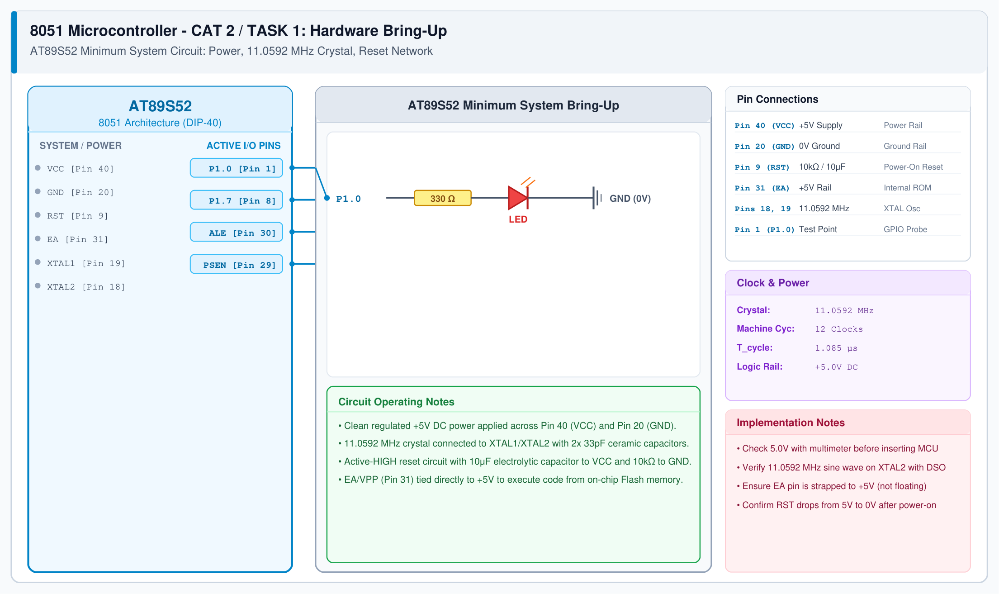

# CAT 2 - Task 1: 8051 Hardware Bring-Up

## 1. Experiment Name
**8051 Development Board Tool Chain Setup & Hardware Bring-Up**

## 2. Hardware Setup and Components
- 1x AT89S52 8051 Microcontroller (DIP-40)
- 1x 11.0592 MHz Quartz Crystal
- 2x 33 pF Ceramic Capacitors (C1, C2)
- 1x 10 μF Electrolytic Capacitor (Reset circuit)
- 1x 10 kΩ Resistor (Reset pull-down)
- 1x Tactile Reset Push-Button
- 1x 0.1 μF Decoupling Capacitor
- Regulated +5V DC Bench Power Supply / USB Supply

## 3. Circuit Diagram

## 4. Required Pin Connections
| MCU Pin | Connected To | Function / Description |
|---|---|---|
| Pin 40 (VCC) | +5.0V DC Rail | Main digital power supply |
| Pin 20 (GND) | 0.0V Ground | System common ground |
| Pin 9 (RST) | 10 μF to VCC, 10 kΩ to GND | Power-on reset circuit (active-HIGH pulse) |
| Pin 31 (EA/VPP) | +5.0V (VCC) | Forces program execution from on-chip 8KB Flash |
| Pin 19 (XTAL1) | 11.0592 MHz Crystal + 33 pF to GND | Oscillator input |
| Pin 18 (XTAL2) | 11.0592 MHz Crystal + 33 pF to GND | Oscillator output |

## 5. Clock Configuration
- External crystal frequency: **11.0592 MHz**
- Machine cycle: 12 clock cycles per machine cycle
- Machine cycle time ($T_{cyc}$): $12 / 11.0592\text{ MHz} \approx 1.085\ \mu\text{s}$
- Timer 0/1 clock frequency: $921.6\text{ kHz}$

## 6. Pseudocode / Code Logic
1. Verify regulated 5V DC across VCC (Pin 40) and GND (Pin 20) with a digital multimeter.
2. Probe XTAL2 (Pin 18) using an oscilloscope to verify stable 11.0592 MHz clock oscillation.
3. Verify RST pin voltage drops to 0V approximately 10 ms after power-on.
4. Execute test instruction to toggle Port 1 to confirm core bring-up.

## 7. Inference / Conclusion
- The AT89S52 minimum system circuit was successfully wired and verified.
- The 11.0592 MHz crystal oscillator produces a stable clock signal, establishing a machine cycle of 1.085 μs.
- Tying EA/VPP to +5V enables execution from internal ROM, and the RC reset network reliably initializes the CPU on power-up.
