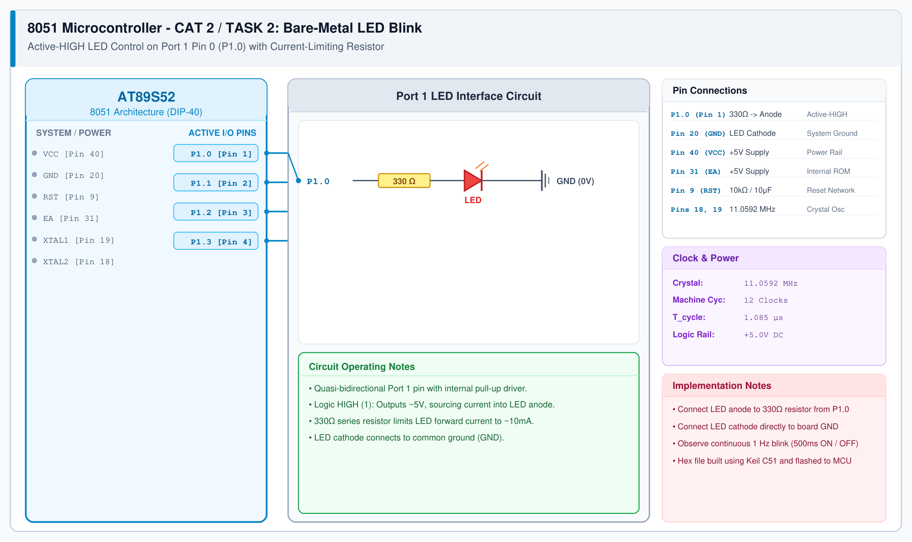

# CAT 2 - Task 2: Bare-Metal LED Blink

## 1. Experiment Name
**8051 Bare-Metal GPIO Output & LED Blink**

## 2. Hardware Setup and Components
- 1x AT89S52 8051 Microcontroller
- 1x 5mm Red LED
- 1x 330 Ω Current-limiting Resistor
- 1x 11.0592 MHz Crystal with 2x 33 pF Capacitors
- +5V DC Power Source & Breadboard

## 3. Circuit Diagram


## 4. Required Pin Connections
| MCU Pin | Connected To | Function |
|---|---|---|
| P1.0 (Pin 1) | 330 Ω Resistor -> LED Anode | Digital output pin driving LED |
| Pin 20 (GND) | LED Cathode | 0V Ground return |
| Pin 40 (VCC) | +5.0V DC | Power supply |
| Pin 31 (EA) | +5.0V DC | Internal ROM select |
| Pin 9 (RST) | Reset RC Circuit | Power-on reset |
| Pins 18, 19 | 11.0592 MHz Crystal | Clock oscillator |

## 5. Clock Configuration
- Clock Source: **11.0592 MHz Crystal**
- Machine Cycle: 12 clock cycles ($1.085\ \mu\text{s}$)
- Software delay loop: Calibrated nested loops producing approximately 500 ms delay intervals.

## 6. Pseudocode / Code Logic
1. Define LED on bit `P1^0`.
2. Implement delay function using nested `for` loops.
3. In `main()` loop:
   - Turn LED ON (`LED = 1`).
   - Call `delay()`.
   - Turn LED OFF (`LED = 0`).
   - Call `delay()`.

```c
#include <reg51.h>

sbit LED = P1^0;

void delay() {
    unsigned int i, j;
    for (i = 0; i < 500; i++) {
        for (j = 0; j < 500; j++);
    }
}

void main() {
    while (1) {
        LED = 1;
        delay();
        LED = 0;
        delay();
    }
}
```

## 7. Inference / Conclusion
- Successfully toggled Port 1 Pin 0 to blink an external LED at ~1 Hz.
- Port 1 pins function as quasi-bidirectional outputs; setting `P1.0 = 1` sources current through the 330Ω resistor to light the LED.
- Keil C51 project compiles cleanly with 0 errors and generates the `.hex` binary for flashing.
