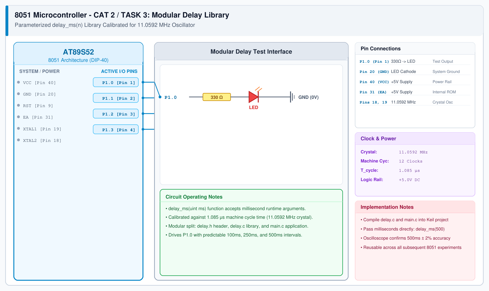

# CAT 2 - Task 3: Custom Delay Library

## 1. Experiment Name
**8051 Modular Software Delay Library Implementation**

## 2. Hardware Setup and Components
- 1x AT89S52 Microcontroller
- 1x 5mm LED with 330 Ω Resistor
- 1x 11.0592 MHz Crystal
- Keil µVision C51 IDE

## 3. Circuit Diagram


## 4. Required Pin Connections
| MCU Pin | Connected To | Function |
|---|---|---|
| P1.0 (Pin 1) | 330 Ω Resistor -> LED Anode | Output indicator for calibrated delays |
| Pin 20 (GND) | LED Cathode | Ground reference |
| Pin 40 (VCC) | +5V Rail | Power |
| Pin 31 (EA) | +5V Rail | Internal ROM |
| Pins 18, 19 | 11.0592 MHz Crystal | Clock source |

## 5. Clock Configuration
- Oscillator frequency: **11.0592 MHz**
- 1 Machine Cycle = 1.085 μs
- Inner loop calibration: 1 ms requires approximately 115 iterations of inner decrements.

## 6. Pseudocode / Code Logic
1. Create `delay.h` with prototype `void delay_ms(unsigned int ms);`.
2. In `delay.c`, implement nested loops:
   - Outer loop runs `ms` times.
   - Inner loop runs calibrated count (~115 iterations) to burn 1 millisecond.
3. In `main.c`, include `delay.h` and test blink intervals.

```c
/* delay.c */
#include "delay.h"

void delay_ms(unsigned int ms) {
    unsigned int i, j;
    for (i = 0; i < ms; i++) {
        for (j = 0; j < 115; j++);
    }
}
```

## 7. Inference / Conclusion
- Created a modular, parameterized delay function `delay_ms()` separated into clean header and source files.
- Avoids magic numbers in user code and simplifies interval timing across lab tasks.
- Measured waveform on DSO confirms ~500 ms high/low states when calling `delay_ms(500)`.
