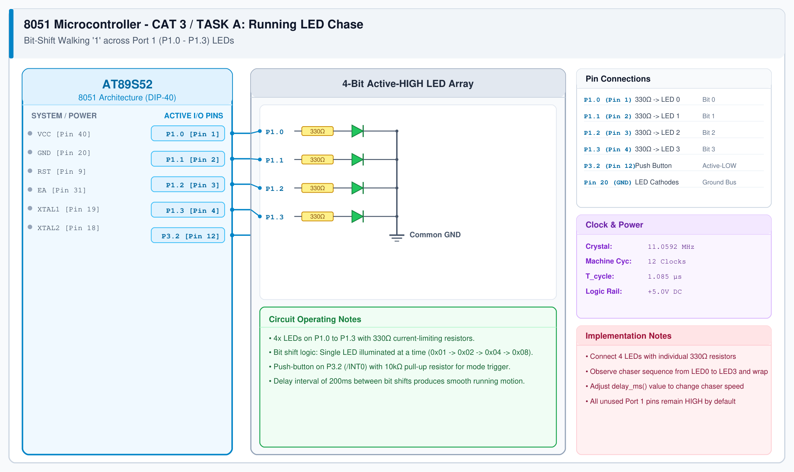

# CAT 3 - Task A: Running LED Pattern

## 1. Experiment Name
**8051 Port 1 LED Pattern Controller – Mode 1: Running LED**

## 2. Hardware Setup and Components
- 1x AT89S52 8051 Microcontroller
- 4x 5mm Green LEDs
- 4x 330 Ω Current-limiting Resistors
- 1x Tactile Push-Button + 10 kΩ Pull-up Resistor
- 11.0592 MHz Crystal Oscillator + Breadboard

## 3. Circuit Diagram


## 4. Required Pin Connections
| MCU Pin | Connected To | Function |
|---|---|---|
| P1.0 (Pin 1) | 330 Ω -> LED 0 Anode | Chase Bit 0 |
| P1.1 (Pin 2) | 330 Ω -> LED 1 Anode | Chase Bit 1 |
| P1.2 (Pin 3) | 330 Ω -> LED 2 Anode | Chase Bit 2 |
| P1.3 (Pin 4) | 330 Ω -> LED 3 Anode | Chase Bit 3 |
| P3.2 (Pin 12) | Push Button to GND | Mode Select (Active-LOW) |
| Pin 20 (GND) | Common LED Cathodes | System Ground |

## 5. Clock Configuration
- Clock Frequency: **11.0592 MHz**
- Machine Cycle: 1.085 μs
- Timing Interval: 200 ms per step using calibrated software delay.

## 6. Pseudocode / Code Logic
1. Initialize Port 1 with pattern `0x01` (binary `0000 0001`).
2. Loop:
   - Output pattern to `P1`.
   - Call `delay_ms(200)`.
   - Shift pattern left: `pattern = pattern << 1`.
   - If pattern exceeds `0x08`, reset back to `0x01`.

```c
#include <reg51.h>

void delay_ms(unsigned int ms) {
    unsigned int i, j;
    for (i = 0; i < ms; i++) {
        for (j = 0; j < 115; j++);
    }
}

void main() {
    unsigned char pattern = 0x01;
    while (1) {
        P1 = pattern;
        delay_ms(200);
        pattern = pattern << 1;
        if (pattern > 0x08) {
            pattern = 0x01;
        }
    }
}
```

## 7. Inference / Conclusion
- Successfully verified bit-shifting output operations across Port 1.
- Only one LED lights at any instant, shifting sequentially from P1.0 up to P1.3 with a 200 ms interval.
- Demonstrates direct whole-port byte manipulation in Keil C51.
