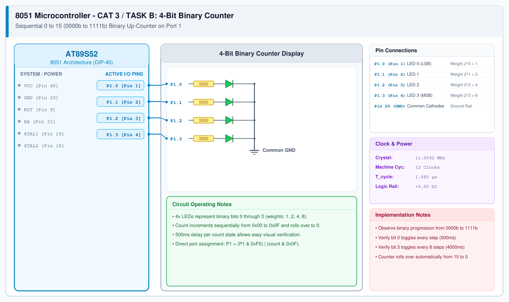

# CAT 3 - Task B: 4-Bit Binary Counter

## 1. Experiment Name
**8051 Port 1 LED Pattern Controller – Mode 2: Binary Up-Counter**

## 2. Hardware Setup and Components
- 1x AT89S52 Microcontroller
- 4x LEDs (LSB to MSB) with 330 Ω Resistors
- 11.0592 MHz Crystal Oscillator & 5V Power Supply

## 3. Circuit Diagram


## 4. Required Pin Connections
| MCU Pin | Connected To | Function |
|---|---|---|
| P1.0 (Pin 1) | 330 Ω -> LED 0 | Bit 0 (LSB, Weight 1) |
| P1.1 (Pin 2) | 330 Ω -> LED 1 | Bit 1 (Weight 2) |
| P1.2 (Pin 3) | 330 Ω -> LED 2 | Bit 2 (Weight 4) |
| P1.3 (Pin 4) | 330 Ω -> LED 3 | Bit 3 (MSB, Weight 8) |
| Pin 20 (GND) | Common Cathodes | 0V Ground |

## 5. Clock Configuration
- Oscillator: **11.0592 MHz Crystal**
- Machine Cycle: 1.085 μs
- Step Delay: 500 ms per count.

## 6. Pseudocode / Code Logic
1. Initialize 8-bit counter variable `count = 0`.
2. In an infinite loop:
   - Output low nibble to Port 1: `P1 = count & 0x0F`.
   - Call `delay_ms(500)`.
   - Increment `count = (count + 1) & 0x0F`.

```c
#include <reg51.h>

void delay_ms(unsigned int ms) {
    unsigned int i, j;
    for (i = 0; i < ms; i++) {
        for (j = 0; j < 115; j++);
    }
}

void main() {
    unsigned char count = 0;
    while (1) {
        P1 = count & 0x0F;
        delay_ms(500);
        count = (count + 1) & 0x0F;
    }
}
```

## 7. Inference / Conclusion
- Successfully verified binary counting on Port 1.
- The 4 LEDs represent states 0 to 15 in true binary code.
- Masking with `& 0x0F` ensures upper nibble pins (P1.4-P1.7) are not altered.
