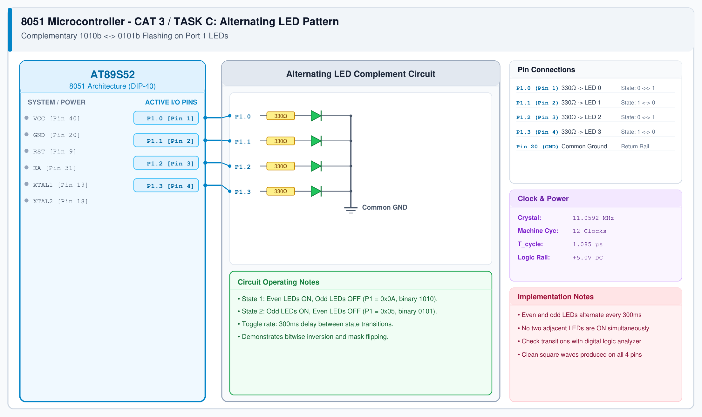

# CAT 3 - Task C: Alternating LED Pattern

## 1. Experiment Name
**8051 Port 1 LED Pattern Controller – Mode 3: Alternating Pattern**

## 2. Hardware Setup and Components
- 1x AT89S52 8051 MCU
- 4x LEDs with 330 Ω Resistors
- 11.0592 MHz Crystal & +5V Power Supply

## 3. Circuit Diagram


## 4. Required Pin Connections
| MCU Pin | Connected To | Function |
|---|---|---|
| P1.0 (Pin 1) | 330 Ω -> LED 0 | Pattern Bit 0 |
| P1.1 (Pin 2) | 330 Ω -> LED 1 | Pattern Bit 1 |
| P1.2 (Pin 3) | 330 Ω -> LED 2 | Pattern Bit 2 |
| P1.3 (Pin 4) | 330 Ω -> LED 3 | Pattern Bit 3 |
| Pin 20 (GND) | Common Cathodes | 0V Ground |

## 5. Clock Configuration
- Clock: **11.0592 MHz Crystal**
- Machine Cycle: 1.085 μs
- Switch Interval: 300 ms per phase.

## 6. Pseudocode / Code Logic
1. Loop continuously:
   - Output `0x0A` (binary `1010`) to Port 1.
   - Delay 300 ms.
   - Output `0x05` (binary `0101`) to Port 1.
   - Delay 300 ms.

```c
#include <reg51.h>

void delay_ms(unsigned int ms) {
    unsigned int i, j;
    for (i = 0; i < ms; i++) {
        for (j = 0; j < 115; j++);
    }
}

void main() {
    while (1) {
        P1 = 0x0A;
        delay_ms(300);
        P1 = 0x05;
        delay_ms(300);
    }
}
```

## 7. Inference / Conclusion
- Successfully verified complementary alternating output states.
- Alternating bit masks (`0x0A` and `0x05`) create an alternating visual hazard flash.
- Confirmed fast port update response on 8051 GPIO.
