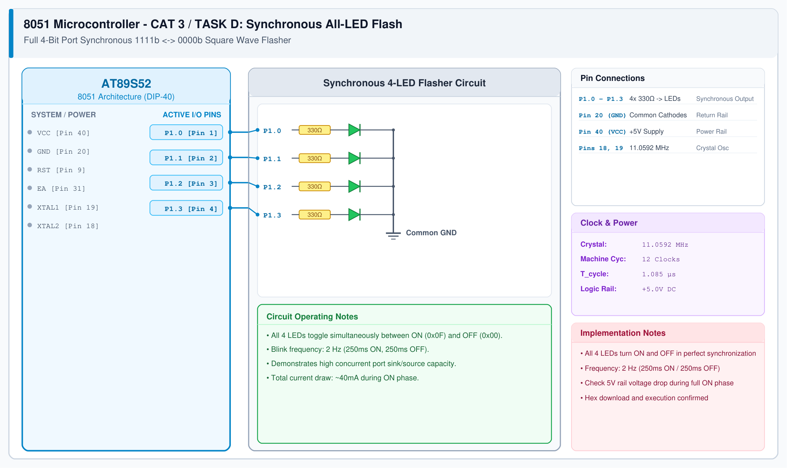

# CAT 3 - Task D: All-LED Synchronous Flash

## 1. Experiment Name
**8051 Port 1 LED Pattern Controller – Mode 4: All-LED Flash**

## 2. Hardware Setup and Components
- 1x AT89S52 Microcontroller
- 4x LEDs with 330 Ω Resistors
- 11.0592 MHz Crystal & +5V Bench Power Supply

## 3. Circuit Diagram


## 4. Required Pin Connections
| MCU Pin | Connected To | Function |
|---|---|---|
| P1.0 - P1.3 (Pins 1-4) | 330 Ω -> 4x LED Anodes | Synchronous 4-bit bus output |
| Pin 20 (GND) | Common LED Cathodes | System Ground |
| Pin 40 (VCC) | +5V Rail | Main Supply |

## 5. Clock Configuration
- Clock: **11.0592 MHz Crystal**
- Machine Cycle: 1.085 μs
- Blink Period: 500 ms (250 ms ON, 250 ms OFF = 2 Hz frequency).

## 6. Pseudocode / Code Logic
1. Loop forever:
   - Set `P1 = 0x0F` (All 4 LEDs ON).
   - Delay 250 ms.
   - Set `P1 = 0x00` (All 4 LEDs OFF).
   - Delay 250 ms.

```c
#include <reg51.h>

void delay_ms(unsigned int ms) {
    unsigned int i, j;
    for (i = 0; i < ms; i++) {
        for (j = 0; j < 115; j++);
    }
}

void main() {
    while (1) {
        P1 = 0x0F;
        delay_ms(250);
        P1 = 0x00;
        delay_ms(250);
    }
}
```

## 7. Inference / Conclusion
- Successfully verified synchronous multi-pin switching on Port 1.
- All 4 LEDs illuminate and extinguish together at 2 Hz without visible phase jitter.
- Demonstrates simultaneous whole-port write execution in a single machine cycle instruction (`MOV P1, #0Fh`).
