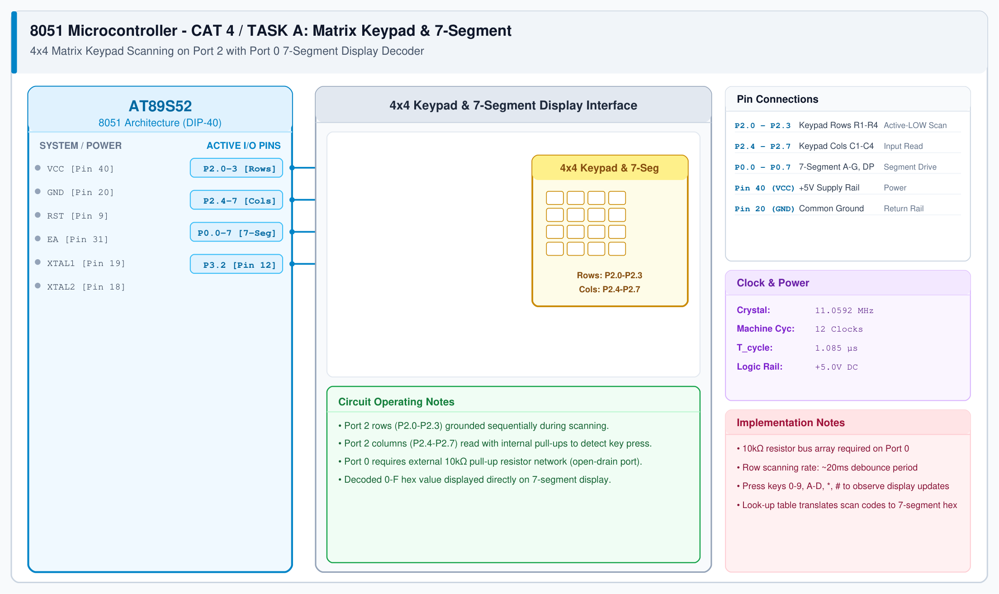

# CAT 4 - Task A: 4x4 Keypad & 7-Segment Display

## 1. Experiment Name
**8051 Matrix Keypad Scanning & 7-Segment Hexadecimal Display**

## 2. Hardware Setup and Components
- 1x AT89S52 Microcontroller
- 1x 4x4 Matrix Keypad (16 tactile switches)
- 1x Common Cathode 7-Segment Display
- 1x 10 kΩ 8-Resistor SIP Network (Port 0 pull-ups)
- 8x 330 Ω Resistors (Segment current limiters)
- 11.0592 MHz Crystal & +5V Power Supply

## 3. Circuit Diagram


## 4. Required Pin Connections
| MCU Pin | Connected To | Function |
|---|---|---|
| P2.0 - P2.3 | Keypad Rows R1 - R4 | Active-LOW row drive |
| P2.4 - P2.7 | Keypad Columns C1 - C4 | Column input scan (with pull-ups) |
| P0.0 - P0.7 | 7-Segment Segments A - G, DP | Segment drive (Port 0 with 10k pull-up array) |
| Pin 20 (GND) | 7-Segment Common Cathode | Ground return |

## 5. Clock Configuration
- Clock: **11.0592 MHz Crystal**
- Machine Cycle: 1.085 μs
- Debounce Filter: 20 ms software delay on key detection.

## 6. Pseudocode / Code Logic
1. Pull rows `P2.0-P2.3` LOW one by one.
2. Read column pins `P2.4-P2.7`.
3. If a column reads `0` (pressed):
   - Wait 20 ms to debounce.
   - Look up corresponding 7-segment segment code from LUT.
   - Output segment byte to `P0`.
   - Wait until key is released.

```c
#include <reg51.h>

code unsigned char seg_lut[] = {
    0x3F, 0x06, 0x5B, 0x4F, /* 0, 1, 2, 3 */
    0x66, 0x6D, 0x7D, 0x07, /* 4, 5, 6, 7 */
    0x7F, 0x6F, 0x77, 0x7C, /* 8, 9, A, B */
    0x39, 0x5E, 0x79, 0x71  /* C, D, E, F */
};

void delay_ms(unsigned int ms) {
    unsigned int i, j;
    for (i = 0; i < ms; i++) {
        for (j = 0; j < 115; j++);
    }
}

unsigned char scan_keypad(void) {
    /* Drive row 0 LOW, check cols, etc. */
    P2 = 0xFE; if ((P2 & 0xF0) != 0xF0) return 0;
    P2 = 0xFD; if ((P2 & 0xF0) != 0xF0) return 4;
    P2 = 0xFB; if ((P2 & 0xF0) != 0xF0) return 8;
    P2 = 0xF7; if ((P2 & 0xF0) != 0xF0) return 12;
    return 0xFF;
}

void main(void) {
    unsigned char key;
    P0 = 0x00;
    while (1) {
        key = scan_keypad();
        if (key != 0xFF) {
            delay_ms(20); /* debounce */
            P0 = seg_lut[key];
            while (scan_keypad() != 0xFF); /* wait for release */
        }
    }
}
```

## 7. Inference / Conclusion
- Successfully multiplexed a 4x4 matrix keypad using 8 pins on Port 2.
- Verified that Port 0 requires external pull-ups because its output drivers are open-drain.
- Keypad debounce prevents multiple triggers, and the look-up table renders hex characters accurately on the 7-segment display.
