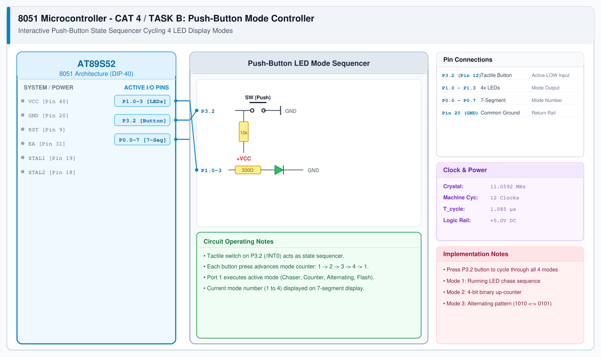

# CAT 4 - Task B: Multi-Mode LED Controller

## 1. Experiment Name
**8051 Push-Button Interactive State Machine & Multi-Mode LED Controller**

## 2. Hardware Setup and Components
- 1x AT89S52 Microcontroller
- 4x LEDs with 330 Ω Resistors
- 1x Push-Button Switch with 10 kΩ Pull-up Resistor
- 1x 7-Segment Display with 10 kΩ Resistor SIP Array
- 11.0592 MHz Crystal Oscillator

## 3. Circuit Diagram

## 4. Required Pin Connections
| MCU Pin | Connected To | Function |
|---|---|---|
| P3.2 (Pin 12) | Push Button to GND | Mode cycle trigger (Active-LOW) |
| P1.0 - P1.3 | 4x LEDs with 330 Ω resistors | Pattern animation output |
| P0.0 - P0.7 | 7-Segment Display | Displays active mode number (1-4) |
| Pin 20 (GND) | Switch & Cathodes GND | Common 0V |

## 5. Clock Configuration
- Clock: **11.0592 MHz Crystal**
- Machine Cycle: 1.085 μs
- Debounce Period: 50 ms on button press.

## 6. Pseudocode / Code Logic
1. State variable `mode = 1`.
2. Continuously check `P3.2`:
   - If pressed (LOW), wait 50 ms debounce, wait for release, then `mode = (mode % 4) + 1`.
   - Update 7-segment on `P0` with current `mode`.
   - Execute single animation frame corresponding to `mode` on `P1`.

## 7. Inference / Conclusion
- Successfully built an interactive finite-state machine (FSM) cycling 4 animation modes.
- Software debouncing reliably filters out mechanical contact chatter.
- Port 1 outputs pattern animations while Port 0 displays the current state number in real time.
