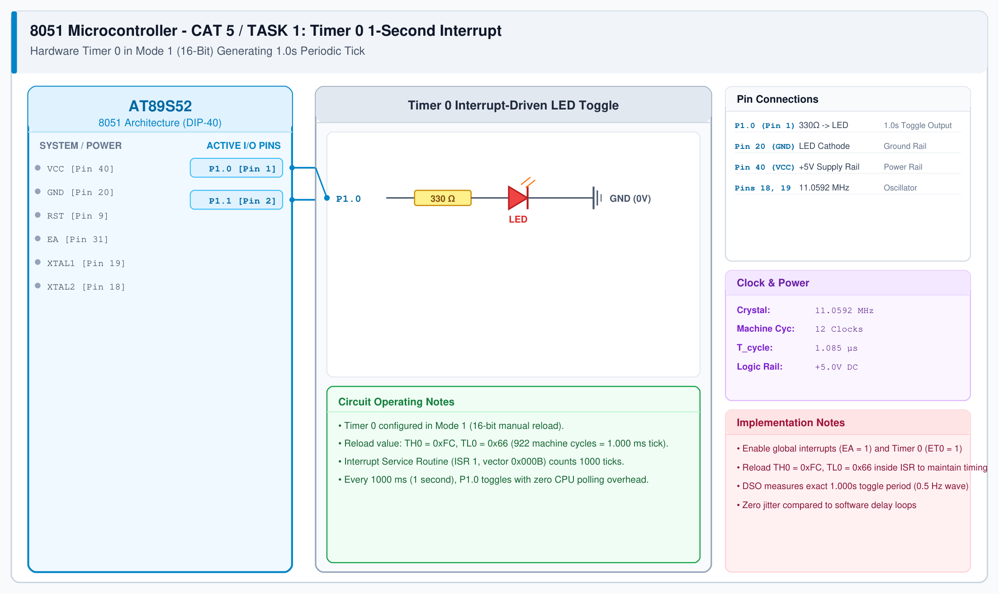

# CAT 5 - Task 1: Timer 0 Periodic Interrupt

## 1. Experiment Name
**8051 Hardware Timer 0 Interrupt-Driven 1-Second Clock Generator**

## 2. Hardware Setup and Components
- 1x AT89S52 Microcontroller
- 1x 5mm LED with 330 Ω Resistor
- 11.0592 MHz Crystal Oscillator & 5V Power Supply

## 3. Circuit Diagram


## 4. Required Pin Connections
| MCU Pin | Connected To | Function |
|---|---|---|
| P1.0 (Pin 1) | 330 Ω -> LED Anode | Toggles every 1.0 second |
| Pin 20 (GND) | LED Cathode | System Ground |
| Pin 40 (VCC) | +5V Rail | Power |

## 5. Clock Configuration
- External Crystal: **11.0592 MHz**
- Timer Input Frequency: $11.0592\text{ MHz} / 12 = 921.6\text{ kHz}$
- Timer Tick Duration: $1 / 921.6\text{ kHz} \approx 1.085\ \mu\text{s}$
- Mode: **Timer 0, Mode 1 (16-bit)**
- Reload Calculation for 1 ms tick:
  $$\text{Counts} = \frac{1000\ \mu\text{s}}{1.085\ \mu\text{s}} = 922$$
  $$\text{Reload} = 65536 - 922 = 64614 = \text{0xFC66}$$

## 6. Pseudocode / Code Logic
1. Configure `TMOD = 0x01` (Timer 0 Mode 1).
2. Load initial values `TH0 = 0xFC`, `TL0 = 0x66`.
3. Enable interrupts: `ET0 = 1`, `EA = 1`, and start timer `TR0 = 1`.
4. In ISR (`interrupt 1`):
   - Reload `TH0 = 0xFC`, `TL0 = 0x66`.
   - Increment `tick_count`.
   - If `tick_count >= 1000`:
     - Toggle `P1.0`.
     - Reset `tick_count = 0`.
5. Background `main()` loop remains completely idle.

```c
#include <reg51.h>

sbit LED = P1^0;
unsigned int tick_count = 0;

void timer0_isr(void) interrupt 1 {
    TH0 = 0xFC;
    TL0 = 0x66;
    tick_count++;
    if (tick_count >= 1000) {
        LED = !LED;
        tick_count = 0;
    }
}

void main(void) {
    TMOD = 0x01;
    TH0 = 0xFC;
    TL0 = 0x66;
    ET0 = 1;
    EA = 1;
    TR0 = 1;
    while (1);
}
```

## 7. Inference / Conclusion
- Replaced software delay loops with hardware Timer 0 interrupts for precise non-blocking timing.
- Reloading `0xFC66` creates an exact 1.0 ms interrupt rate, accumulating to an accurate 1-second toggle period.
- Measured on oscilloscope: Toggle period is 1.000 s (0.5 Hz square wave) with negligible jitter.
