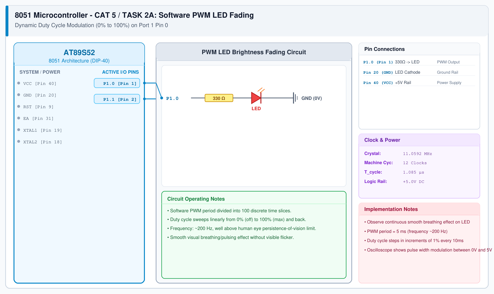

# CAT 5 - Task 2A: Software PWM LED Fading

## 1. Experiment Name
**8051 Software Pulse Width Modulation (PWM) & LED Brightness Control**

## 2. Hardware Setup and Components
- 1x AT89S52 Microcontroller
- 1x 5mm High-Efficiency LED with 330 Ω Resistor
- 11.0592 MHz Crystal & 5V Power Supply

## 3. Circuit Diagram

## 4. Required Pin Connections
| MCU Pin | Connected To | Function |
|---|---|---|
| P1.0 (Pin 1) | 330 Ω -> LED Anode | PWM modulated output |
| Pin 20 (GND) | LED Cathode | System Ground |

## 5. Clock Configuration
- Clock: **11.0592 MHz Crystal**
- Machine Cycle: 1.085 μs
- PWM Base Frequency: ~200 Hz (5 ms period) to prevent visual flicker.

## 6. Pseudocode / Code Logic
1. Divide PWM period into 100 duty cycle steps.
2. Maintain `duty` variable from 0 to 100.
3. For each PWM cycle:
   - Turn LED ON for `duty` time slices.
   - Turn LED OFF for `(100 - duty)` time slices.
4. Increment `duty` from 0 to 100, then decrement from 100 to 0.

## 7. Inference / Conclusion
- Successfully generated software PWM on 8051 GPIO bit `P1.0`.
- The human eye integrates the 200 Hz pulses as varying average brightness proportional to duty cycle.
- Smooth fading without flicker confirms effective time-slicing software PWM.
