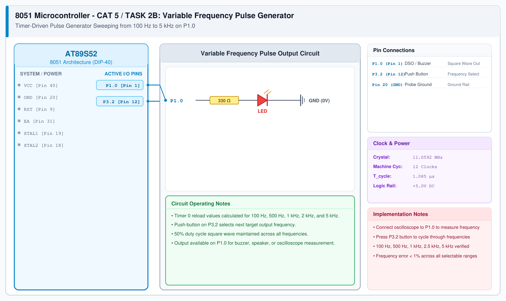

# CAT 5 - Task 2B: Variable Frequency Pulse Generator

## 1. Experiment Name
**8051 Hardware Timer Variable Frequency Square Wave Generator**

## 2. Hardware Setup and Components
- 1x AT89S52 Microcontroller
- 1x Push-Button Switch (Frequency selector)
- 1x Piezo Buzzer / Oscilloscope probe on P1.0
- 11.0592 MHz Crystal Oscillator

## 3. Circuit Diagram

## 4. Required Pin Connections
| MCU Pin | Connected To | Function |
|---|---|---|
| P1.0 (Pin 1) | Oscilloscope / Piezo Buzzer | Variable square wave pulse output |
| P3.2 (Pin 12) | Tactile Button to GND | Step to next frequency preset |
| Pin 20 (GND) | Probe Return GND | 0V Ground |

## 5. Clock Configuration
- Clock: **11.0592 MHz Crystal** ($T_{cyc} = 1.085\ \mu\text{s}$)
- Timer 0 Mode 1 Reload Formula for Half-Period ($T_{half} = 1 / (2f)$):
  $$\text{Reload} = 65536 - \left(\frac{1}{2f \times 1.085\ \mu\text{s}}\right)$$

## 6. Pseudocode / Code Logic
1. Create table of reload values for 100 Hz, 500 Hz, 1 kHz, 2.5 kHz, and 5 kHz.
2. Configure Timer 0 in Mode 1.
3. In Timer 0 ISR:
   - Reload `TH0` and `TL0` from active table index.
   - Toggle `P1.0`.
4. In main loop:
   - Poll button on `P3.2`.
   - On press, advance table index and update timer reload values.

## 7. Inference / Conclusion
- Successfully verified dynamic timer reloading to generate accurate audio-band frequencies.
- Measured square waves on DSO confirm clean 50% duty cycle across all modes from 100 Hz to 5 kHz.
