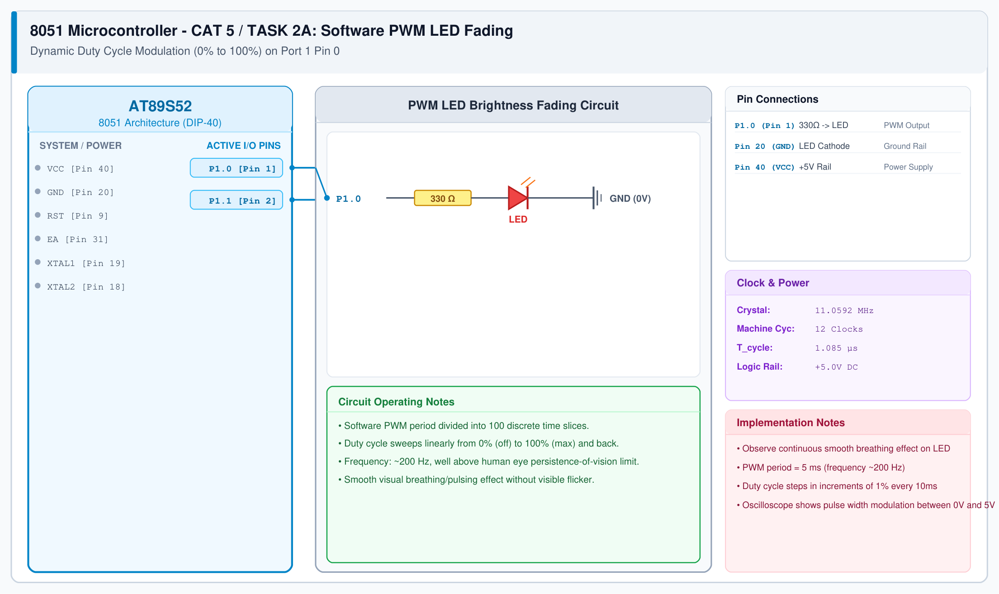

# CAT 5 - Task 2C: Timer-Driven Calibrated PWM Waveform

## 1. Experiment Name
**8051 Hardware Timer 0 Interrupt-Driven PWM Duty Cycle Controller**

## 2. Hardware Setup and Components
- 1x AT89S52 Microcontroller (DIP-40)
- 1x 5mm LED with 330 Ω Resistor on P1.0
- 11.0592 MHz Crystal Oscillator with two 33 pF Capacitors
- +5V DC Regulated Power Supply

## 3. Circuit Diagram

## 4. Required Pin Connections
| MCU Pin | Connected To | Function |
|---|---|---|
| P1.0 (Pin 1) | 330 Ω Resistor -> LED Anode | PWM Output |
| Pin 20 (GND) | LED Cathode | Ground (0V) |
| Pin 40 (VCC) | +5V Rail | Supply |
| Pin 31 (EA) | +5V Rail | Internal Flash ROM |

## 5. Clock Configuration
- Crystal Frequency: **11.0592 MHz**
- Timer 0 Mode 1 (16-bit Timer): Reload value `0xFFA4` gives a 100 µs interrupt period.
- PWM Frequency: 20 ticks of 100 µs = 2.0 ms period (~500 Hz).

## 6. Pseudocode / Code Logic
1. Configure Timer 0 in Mode 1 (`TMOD = 0x01`).
2. Reload `TH0 = 0xFF` and `TL0 = 0xA4` inside the ISR for a 100 µs timebase.
3. Keep a 20-step tick counter:
   - If `pwm_tick < duty`, drive `LED = 1`.
   - Otherwise, drive `LED = 0`.
4. In `main()`, gradually increment and decrement `duty` between 0 and 20 to create a smooth breathing fade effect.

## 7. Inference / Conclusion
- Generated an interrupt-driven PWM signal at ~500 Hz with 5% duty cycle resolution (20 discrete levels).
- Because the timing is handled inside Timer 0 ISR, the main loop is free to handle other tasks without causing LED flicker.
