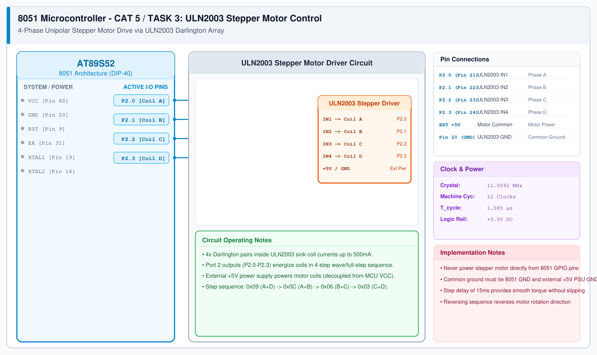

# CAT 5 - Task 3: Stepper Motor Control

## 1. Experiment Name
**8051 Port 2 Interfacing with ULN2003 Darlington Driver & Stepper Motor**

## 2. Hardware Setup and Components
- 1x AT89S52 Microcontroller
- 1x ULN2003 Darlington Transistor Array Board
- 1x 28BYJ-48 5V Unipolar Stepper Motor
- External +5V DC 1A Power Supply
- 11.0592 MHz Crystal Oscillator

## 3. Circuit Diagram


## 4. Required Pin Connections
| MCU Pin | Connected To | Function |
|---|---|---|
| P2.0 (Pin 21) | ULN2003 IN1 -> Motor Coil A | Phase 1 control |
| P2.1 (Pin 22) | ULN2003 IN2 -> Motor Coil B | Phase 2 control |
| P2.2 (Pin 23) | ULN2003 IN3 -> Motor Coil C | Phase 3 control |
| P2.3 (Pin 24) | ULN2003 IN4 -> Motor Coil D | Phase 4 control |
| Pin 20 (GND) | ULN2003 GND & Power GND | Common Ground |
| External +5V | ULN2003 COM & Motor Red wire | Motor coil supply rail |

## 5. Clock Configuration
- Clock: **11.0592 MHz Crystal**
- Machine Cycle: 1.085 μs
- Step Delay: 15 ms between phase transitions for smooth torque.

## 6. Pseudocode / Code Logic
1. Define full-step excitation sequence array: `{0x09, 0x0C, 0x06, 0x03}`.
2. In loop:
   - For forward rotation: Step index `0 -> 1 -> 2 -> 3`.
   - Write step byte to `P2`.
   - Delay 15 ms.
   - For reverse rotation: Step index `3 -> 2 -> 1 -> 0`.

```c
#include <reg51.h>

code unsigned char step_sequence[4] = {0x09, 0x0C, 0x06, 0x03};

void delay_ms(unsigned int ms) {
    unsigned int i, j;
    for (i = 0; i < ms; i++) {
        for (j = 0; j < 115; j++);
    }
}

void main(void) {
    unsigned char i;
    while (1) {
        /* Rotate Forward */
        for (i = 0; i < 4; i++) {
            P2 = step_sequence[i];
            delay_ms(15);
        }
    }
}
```

## 7. Inference / Conclusion
- Successfully interfaced the AT89S52 with a 4-phase stepper motor via the ULN2003 Darlington driver.
- The ULN2003 amplifies low-current MCU GPIO signals into the ~200 mA coil currents required to actuate the rotor.
- Full-step excitation provides robust torque with predictable rotational stepping.
