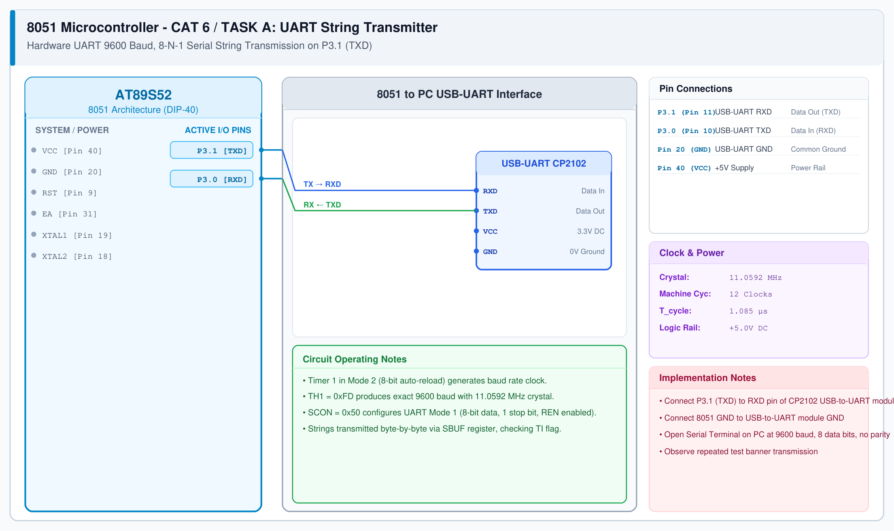

# CAT 6 - Task A: UART String Transmitter

## 1. Experiment Name
**8051 Hardware UART 9600 Baud Serial String Transmitter**

## 2. Hardware Setup and Components
- 1x AT89S52 Microcontroller
- 1x CP2102 / CH340 USB-to-UART Module
- 1x 11.0592 MHz Crystal (Crucial for exact standard baud rates)
- PC running Serial Terminal (PuTTY / Tera Term / VS Code)

## 3. Circuit Diagram


## 4. Required Pin Connections
| MCU Pin | Connected To | Function |
|---|---|---|
| P3.1 (Pin 11, TXD) | USB-UART RXD | 8051 Serial Data Output |
| P3.0 (Pin 10, RXD) | USB-UART TXD | 8051 Serial Data Input |
| Pin 20 (GND) | USB-UART GND | Signal Ground Reference |

## 5. Clock Configuration
- Crystal Frequency: **11.0592 MHz**
- Timer 1: **Mode 2 (8-bit auto-reload)**
- Baud Rate: **9600 bps**
- Reload Calculation ($SMOD = 0$):
  $$TH1 = 256 - \frac{11.0592\text{ MHz}}{384 \times 9600} = 256 - 3 = 253 = \text{0xFD}$$

## 6. Pseudocode / Code Logic
1. Set `TMOD |= 0x20` (Timer 1 Mode 2).
2. Set `TH1 = 0xFD` (9600 baud reload).
3. Set `SCON = 0x50` (Mode 1 8-bit UART, enable receiver).
4. Set `TR1 = 1` (Start Timer 1).
5. Function `uart_tx_char(ch)`:
   - Write `SBUF = ch`.
   - Poll `while (TI == 0);`.
   - Clear `TI = 0`.
6. Function `uart_tx_string(str)`: Send characters until `\0`.

```c
#include <reg51.h>

void uart_init(void) {
    TMOD |= 0x20;
    TH1 = 0xFD;
    SCON = 0x50;
    TR1 = 1;
}

void uart_tx_char(char c) {
    SBUF = c;
    while (TI == 0);
    TI = 0;
}

void uart_tx_string(const char *str) {
    while (*str) {
        uart_tx_char(*str++);
    }
}

void main(void) {
    uart_init();
    while (1) {
        uart_tx_string("Hello from AT89S52 8051 UART\r\n");
        /* delay between messages */
    }
}
```

## 7. Inference / Conclusion
- Successfully verified hardware UART serial transmission at 9600 baud.
- The 11.0592 MHz crystal provides exact integer division for standard serial baud rates with zero percent error ($TH1 = 0xFD$).
- Text strings received cleanly on PC serial terminal without garbled characters.
