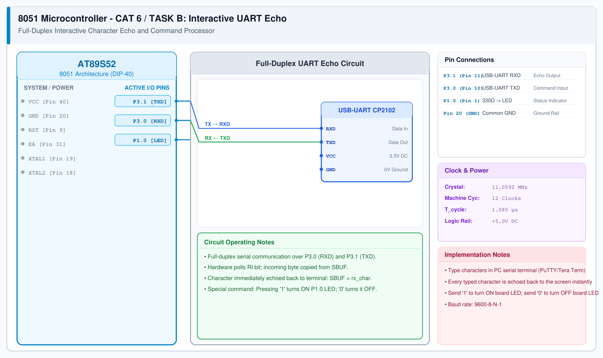

# CAT 6 - Task B: Interactive UART Echo & Command Controller

## 1. Experiment Name
**8051 Full-Duplex UART Character Echo & Serial Command Interpreter**

## 2. Hardware Setup and Components
- 1x AT89S52 Microcontroller
- 1x USB-to-UART Serial Converter
- 1x LED with 330 Ω Resistor on P1.0
- 11.0592 MHz Crystal Oscillator

## 3. Circuit Diagram

## 4. Required Pin Connections
| MCU Pin | Connected To | Function |
|---|---|---|
| P3.0 (Pin 10, RXD) | USB-UART TXD | Receives typed keys from PC |
| P3.1 (Pin 11, TXD) | USB-UART RXD | Transmits echoed bytes to PC |
| P1.0 (Pin 1) | 330 Ω -> LED Anode | Controlled by serial commands |
| Pin 20 (GND) | USB-UART GND | Common Ground |

## 5. Clock Configuration
- Crystal: **11.0592 MHz**
- Timer 1 Mode 2: `TH1 = 0xFD` (9600 baud, 8-N-1).

## 6. Pseudocode / Code Logic
1. Initialize UART for 9600 baud.
2. In loop:
   - Poll `while (RI == 0);`.
   - Read character `ch = SBUF; RI = 0;`.
   - Echo character back: `SBUF = ch; while (TI == 0); TI = 0;`.
   - If `ch == '1'`, set `P1.0 = 1` (LED ON).
   - If `ch == '0'`, set `P1.0 = 0` (LED OFF).

## 7. Inference / Conclusion
- Verified full-duplex UART reception and transmission.
- Typed characters appear immediately in the terminal console, demonstrating sub-millisecond echo latency.
- Command decoding ('1' / '0') confirms reliable serial peripheral actuation.
