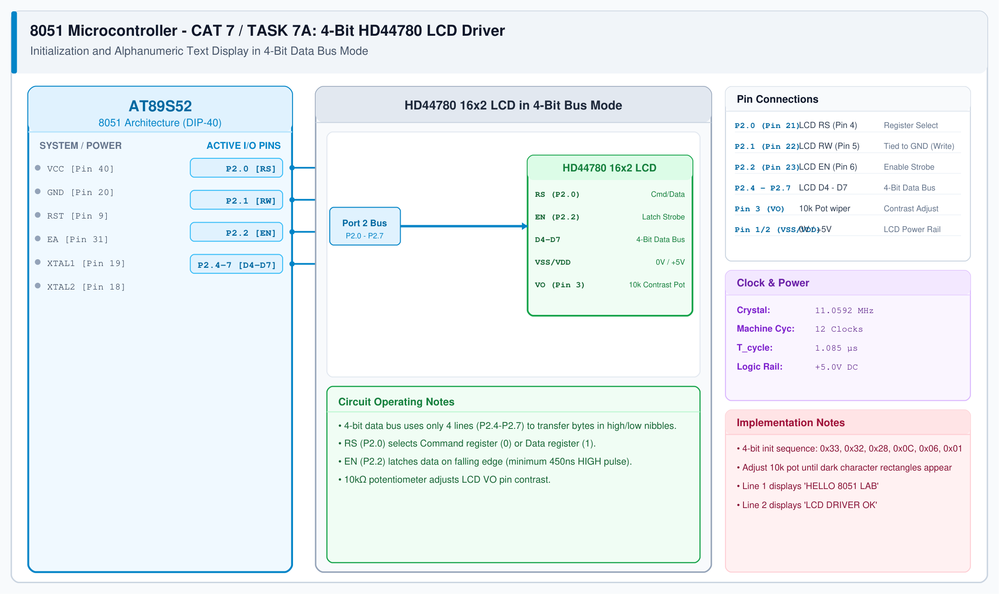

# CAT 7 - Task 7A: HD44780 LCD 4-Bit Driver

## 1. Experiment Name
**8051 HD44780 16x2 Character LCD 4-Bit Mode Initialization & Display**

## 2. Hardware Setup and Components
- 1x AT89S52 Microcontroller
- 1x 16x2 Alphanumeric LCD Module (HD44780 compliant)
- 1x 10 kΩ Trimpot (Contrast adjustment)
- 11.0592 MHz Crystal Oscillator & 5V Power Supply

## 3. Circuit Diagram


## 4. Required Pin Connections
| MCU Pin | Connected To | Function |
|---|---|---|
| P2.0 (Pin 21) | LCD RS (Pin 4) | Register Select (0 = Command, 1 = Data) |
| P2.1 (Pin 22) | LCD RW (Pin 5) | Tied to GND (Write Mode) |
| P2.2 (Pin 23) | LCD EN (Pin 6) | Enable pulse (latches data on falling edge) |
| P2.4 - P2.7 | LCD D4 - D7 (Pins 11-14) | 4-bit data bus (transfers high nibble, then low nibble) |
| - | LCD VO (Pin 3) | Wiper of 10 kΩ pot between 5V and GND (Contrast) |
| - | LCD VDD / VSS | +5V (Pin 2) / 0V Ground (Pin 1) |

## 5. Clock Configuration
- Clock: **11.0592 MHz Crystal**
- Machine Cycle: 1.085 μs
- Timing Delays: 4-bit initialization commands require >4.1 ms delays; standard commands require >40 μs.

## 6. Pseudocode / Code Logic
1. 4-bit initialization sequence:
   - Send `0x33`, `0x32` to force LCD into 4-bit mode.
   - Send `0x28` (4-bit, 2 lines, 5x8 font).
   - Send `0x0C` (Display ON, cursor OFF).
   - Send `0x06` (Entry mode, auto increment cursor).
   - Send `0x01` (Clear display).
2. Function `lcd_send_nibble(n)`: Place nibble on P2.4-P2.7, pulse EN high then low.
3. Function `lcd_write_char(c)`: Send high nibble, then low nibble with `RS = 1`.
4. Display target strings on Line 1 (`0x80`) and Line 2 (`0xC0`).

```c
#include <reg51.h>
#include "lcd_4bit.h"

void main(void) {
    lcd_init();
    lcd_set_cursor(1, 0);
    lcd_print("HELLO 8051 LAB");
    lcd_set_cursor(2, 0);
    lcd_print("LCD DRIVER OK");
    while (1);
}
```

## 7. Inference / Conclusion
- Successfully initialized the HD44780 LCD controller in 4-bit mode, saving 4 valuable MCU GPIO pins compared to 8-bit mode.
- Verified that splitting bytes into high and low nibbles with pulsed EN enables clean, crisp text rendering on both lines.
