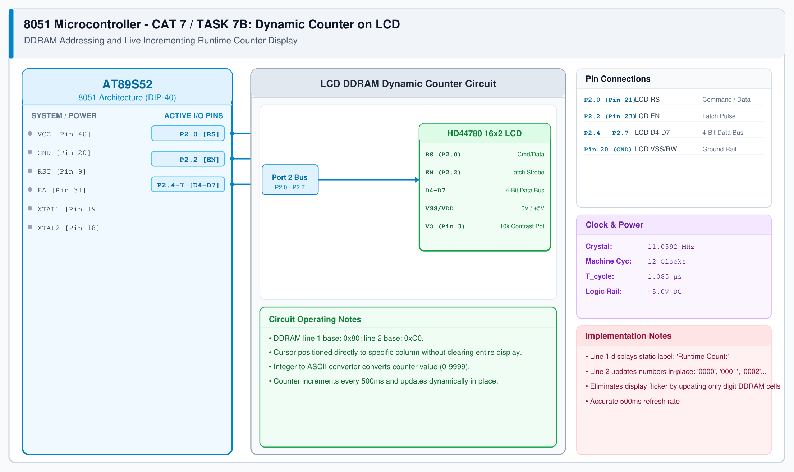

# CAT 7 - Task 7B: Dynamic Counter on LCD

## 1. Experiment Name
**8051 LCD DDRAM Direct Addressing & Live Dynamic Counter Display**

## 2. Hardware Setup and Components
- 1x AT89S52 Microcontroller
- 1x 16x2 LCD Display (4-bit mode)
- 1x 10 kΩ Contrast Potentiometer
- 11.0592 MHz Crystal Oscillator

## 3. Circuit Diagram

## 4. Required Pin Connections
| MCU Pin | Connected To | Function |
|---|---|---|
| P2.0 (Pin 21) | LCD RS | Command / Data Select |
| P2.2 (Pin 23) | LCD EN | Latch Strobe |
| P2.4 - P2.7 | LCD D4 - D7 | 4-bit data bus |
| Pin 20 (GND) | LCD VSS, RW | System Ground |

## 5. Clock Configuration
- Clock: **11.0592 MHz**
- Refresh Rate: 500 ms per count increment.

## 6. Pseudocode / Code Logic
1. Initialize LCD in 4-bit mode.
2. Write static text `"Counter: "` to Line 1 (`0x80`).
3. In loop:
   - Move cursor to Line 2 Column 4 (`0xC4`).
   - Format `count` as 4 ASCII digits (`'0' + (count / 1000)`, etc.).
   - Write formatted digits directly to DDRAM.
   - Delay 500 ms.
   - Increment `count`.

## 7. Inference / Conclusion
- Successfully demonstrated selective DDRAM address updates without clearing the entire screen.
- Overwriting specific character cells eliminates display flicker and preserves static UI headers.
