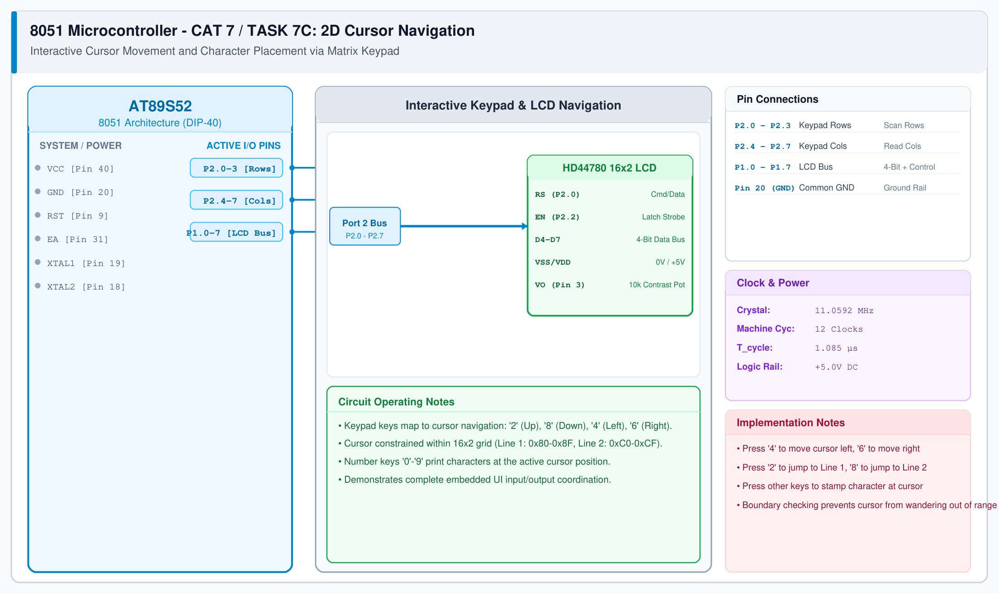

# CAT 7 - Task 7C: 2D Cursor Navigation & Keypad Input

## 1. Experiment Name
**8051 Interactive 2D LCD Cursor Navigation & Matrix Keypad Text Editor**

## 2. Hardware Setup and Components
- 1x AT89S52 Microcontroller
- 1x 16x2 LCD Display Module
- 1x 4x4 Matrix Keypad
- 11.0592 MHz Crystal & 5V Power Supply

## 3. Circuit Diagram

## 4. Required Pin Connections
| MCU Pin | Connected To | Function |
|---|---|---|
| P2.0 - P2.7 | 4x4 Matrix Keypad | Keypad scanning interface |
| P1.0 - P1.6 | 16x2 LCD Display | 4-bit data bus + RS, EN control |
| Pin 20 (GND) | Keypad & LCD GND | System Ground |

## 5. Clock Configuration
- Clock: **11.0592 MHz Crystal**
- Keypad debounce interval: 30 ms.

## 6. Pseudocode / Code Logic
1. Track cursor position `(row, col)` with `row ∈ {1, 2}` and `col ∈ {0 .. 15}`.
2. Initialize LCD with blinking cursor enabled (`0x0F`).
3. In loop:
   - Scan keypad.
   - If '4' pressed (Left): decrement `col` (minimum 0).
   - If '6' pressed (Right): increment `col` (maximum 15).
   - If '2' pressed (Up): `row = 1`.
   - If '8' pressed (Down): `row = 2`.
   - If character key pressed: print character at current `(row, col)` and advance `col`.
   - Update hardware cursor position using DDRAM base address (`0x80` for row 1, `0xC0` for row 2).

## 7. Inference / Conclusion
- Successfully coordinated simultaneous keypad matrix scanning and 16x2 LCD rendering.
- Boundary checking ensures the cursor stays within the physical 16x2 display window.
- Demonstrates a complete embedded user interface architecture with interactive navigation and text entry.
