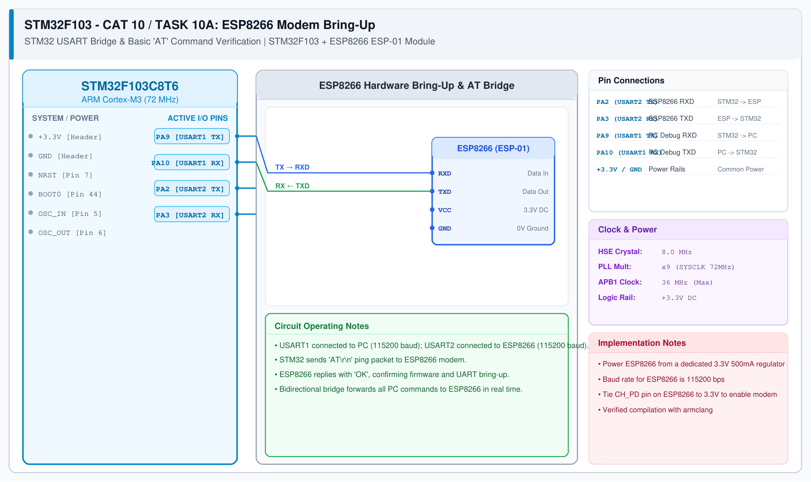

# CAT 10 - Task 10A: ESP8266 AT Modem Bring-Up

## 1. Experiment Name
**STM32 USART Bridge & ESP8266 Modem Initialization**

## 2. Hardware Setup and Components
- 1x STM32 Blue Pill Board (STM32F103C8T6)
- 1x ESP8266 Wi-Fi Module (ESP-01 / Wemos D1 Mini)
- 1x Dedicated 3.3V Power Supply (AMS1117-3.3)
- 1x USB-TTL Serial Adapter for PC Terminal Monitor

## 3. Circuit Diagram

## 4. Required Pin Connections
| STM32 Pin | Connected To | Function |
|---|---|---|
| PA2 (USART2 TX) | ESP8266 RXD | Send AT commands |
| PA3 (USART2 RX) | ESP8266 TXD | Receive modem responses |
| PA9 (USART1 TX) | USB-TTL RXD | Debug log to PC |
| PA10 (USART1 RX) | USB-TTL TXD | Terminal input |
| 3.3V / GND | External 3.3V Supply | Power |

## 5. Clock Configuration
- System Clock: **72 MHz**
- USART1 & USART2 Baud Rate: **115200 bps, 8-N-1**

## 6. Pseudocode / Code Logic
1. Initialize USART1 for PC logging and USART2 for communication with the ESP8266.
2. Send test command `AT\r\n` to the modem.
3. Wait for `OK` response from the ESP8266.
4. Send `AT+GMR\r\n` to query the firmware version and print the response to the PC serial terminal.
5. If the module responds with `OK`, toggle the onboard PC13 LED to indicate ready state.

## 7. Inference / Conclusion
- The ESP8266 initialized properly and returned `OK` over USART2 at 115200 baud.
- Confirmed that hardware UART wiring and power supply rails are stable before configuring network modes.
