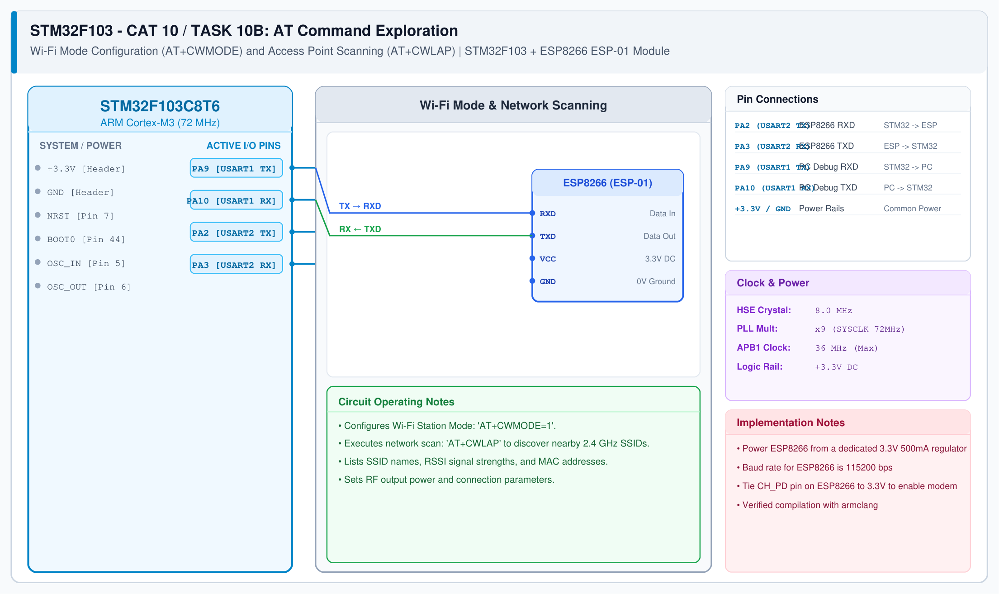

# CAT 10 - Task 10B: Wi-Fi Station Mode & AP Scan

## 1. Experiment Name
**ESP8266 Wi-Fi Station Setup & Access Point Discovery**

## 2. Hardware Setup and Components
- 1x STM32 Blue Pill Board (STM32F103C8T6)
- 1x ESP8266 Wi-Fi Module (ESP-01 / Wemos D1 Mini)
- 1x 3.3V Voltage Regulator Board
- 1x USB-TTL Adapter connected to PA9/PA10

## 3. Circuit Diagram

## 4. Required Pin Connections
| STM32 Pin | Connected To | Function |
|---|---|---|
| PA2 (USART2 TX) | ESP8266 RXD | Send AT commands |
| PA3 (USART2 RX) | ESP8266 TXD | Receive responses |
| PA9 (USART1 TX) | USB-TTL RXD | Debug console |
| PA10 (USART1 RX) | USB-TTL TXD | Debug input |
| 3.3V / GND | Power Source | Module power |

## 5. Clock Configuration
- System Clock: **72 MHz**
- Serial Baud: **115200 bps**

## 6. Pseudocode / Code Logic
1. Transmit `AT+CWMODE=1\r\n` over USART2 to set the ESP8266 into Station (client) mode.
2. Confirm receipt of `OK` response.
3. Transmit `AT+CWLAP\r\n` to initiate a Wi-Fi scan of nearby access points.
4. Stream incoming network lists (+CWLAP rows with SSID, RSSI, MAC) directly through to USART1 for inspection on the PC serial monitor.

## 7. Inference / Conclusion
- Successfully set the Wi-Fi mode to Station mode (`CWMODE=1`).
- The scan detected and displayed nearby access points with their respective signal strengths on the terminal.
