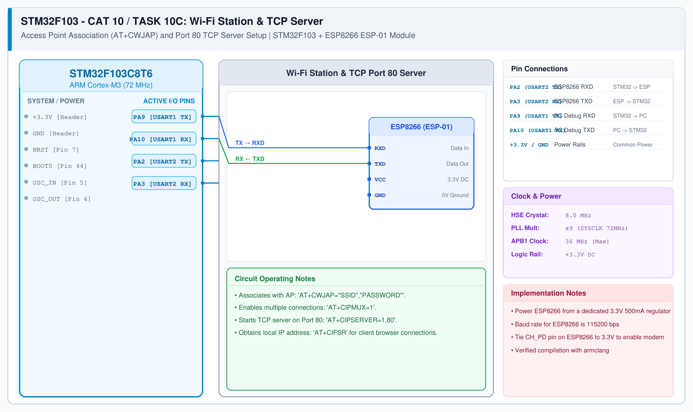

# CAT 11 - Task 11: Embedded TCP Web Server & Node-RED HTTP Interface

## 1. Experiment Name
**STM32 & ESP8266 Local HTTP Web Server & Browser Interface**

## 2. Hardware Setup and Components
- 1x STM32 Blue Pill Board (STM32F103C8T6)
- 1x ESP8266 Wi-Fi Module (Wemos D1 Mini / ESP-01)
- 1x Dedicated 3.3V Power Supply
- Host PC / Mobile Browser on the same Wi-Fi network

## 3. Circuit Diagram


## 4. Required Pin Connections
| STM32 Pin | Connected To | Function |
|---|---|---|
| PA2 (USART2 TX) | ESP8266 RXD | Send AT commands & HTTP data |
| PA3 (USART2 RX) | ESP8266 TXD | Receive +IPD client requests |
| PA9 (USART1 TX) | USB-TTL RXD | Debug log output |
| PA10 (USART1 RX) | USB-TTL TXD | Debug input |
| 3.3V / GND | Power Source | Power rails |

## 5. Clock Configuration
- System Clock: **72 MHz**
- Serial Baud Rate: **115200 bps**

## 6. Pseudocode / Code Logic
1. Connect to Wi-Fi access point: `AT+CWJAP="SSID","PASSWORD"`.
2. Query obtained IP address: `AT+CIFSR`.
3. Enable multi-connection mode: `AT+CIPMUX=1`.
4. Start TCP server on port 80: `AT+CIPSERVER=1,80`.
5. Listen for incoming HTTP GET requests notified as `+IPD,<id>,<len>:GET / HTTP/1.1...`.
6. Transmit HTTP response in two steps:
   - Send `AT+CIPSEND=<id>,<length>` and wait for `>` prompt.
   - Send HTTP headers and HTML payload:
     ```
     HTTP/1.1 200 OK\r\n
     Content-Type: text/html\r\n
     Content-Length: 48\r\n\r\n
     <html><body><h1>STM32 IoT Node</h1></body></html>
     ```
7. Close the TCP socket: `AT+CIPCLOSE=<id>`.

## 7. Inference / Conclusion
- Successfully hosted a lightweight web server on the STM32 via the ESP8266 modem.
- Navigating to the ESP8266 IP address in a browser loaded the HTML status page.
- Also verified client requests triggered from a Node-RED `http request` node.
