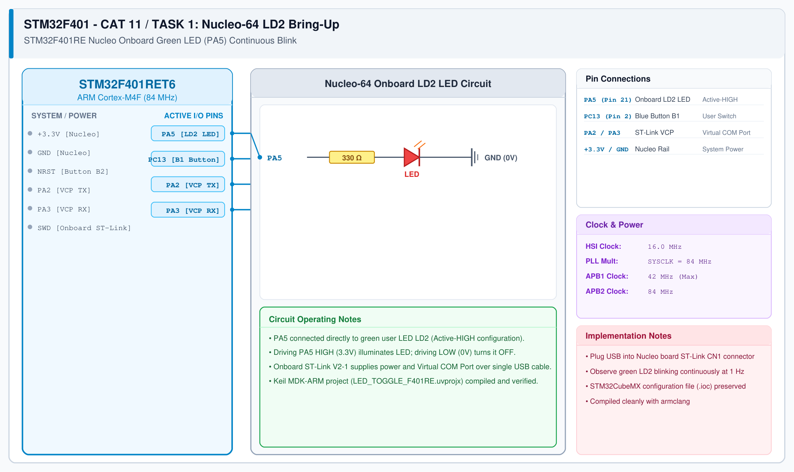

# CAT 12 - Task 12A: Nucleo Onboard LED Bring-Up

## 1. Experiment Name
**STM32F401RE Nucleo-64 Hardware Bring-Up & Onboard LD2 LED Blink**

## 2. Hardware Setup and Components
- 1x STM32 Nucleo-F401RE Development Board (ARM Cortex-M4F with FPU)
- Onboard Green User LED (LD2 connected to PA5)
- Onboard ST-Link V2-1 Debugger
- Mini-USB Cable & Keil MDK-ARM IDE

## 3. Circuit Diagram


## 4. Required Pin Connections
| Nucleo Pin | Target Component | Function |
|---|---|---|
| PA5 | Onboard Green LED (LD2) | Active-HIGH digital output |
| PC13 | Blue User Push-Button (B1) | Digital input (Active-LOW) |
| PA2 / PA3 | ST-Link Virtual COM Port | USART2 TX / RX debug link |
| +3.3V / GND | Onboard Power Rails | Power Supply |

## 5. Clock Configuration
- Clock Source: **Internal 16 MHz RC (HSI) with PLL**
- System Clock: **SYSCLK = 84 MHz**
- AHB Bus: 84 MHz (HCLK)
- APB1 Bus: 42 MHz (PCLK1)
- APB2 Bus: 84 MHz (PCLK2)

## 6. Pseudocode / Code Logic
1. Initialize HAL library and configure system clocks to 84 MHz.
2. Initialize `PA5` as Push-Pull Output (`GPIO_MODE_OUTPUT_PP`, `GPIO_SPEED_FREQ_LOW`).
3. In main loop:
   - Toggle PA5: `HAL_GPIO_TogglePin(GPIOA, GPIO_PIN_5);`
   - Delay 500 ms: `HAL_Delay(500);`

```c
#include "main.h"

int main(void) {
    HAL_Init();
    SystemClock_Config();
    MX_GPIO_Init();

    while (1) {
        HAL_GPIO_TogglePin(GPIOA, GPIO_PIN_5);
        HAL_Delay(500);
    }
}
```

## 7. Inference / Conclusion
- Successfully verified hardware bring-up and toolchain operation for the STM32F401RE Nucleo board.
- Unlike the Blue Pill's active-LOW LED, the Nucleo LD2 is active-HIGH (lights up when PA5 is driven HIGH).
- Complete Keil uVision project and STM32CubeMX `.ioc` configuration preserved and tested.
