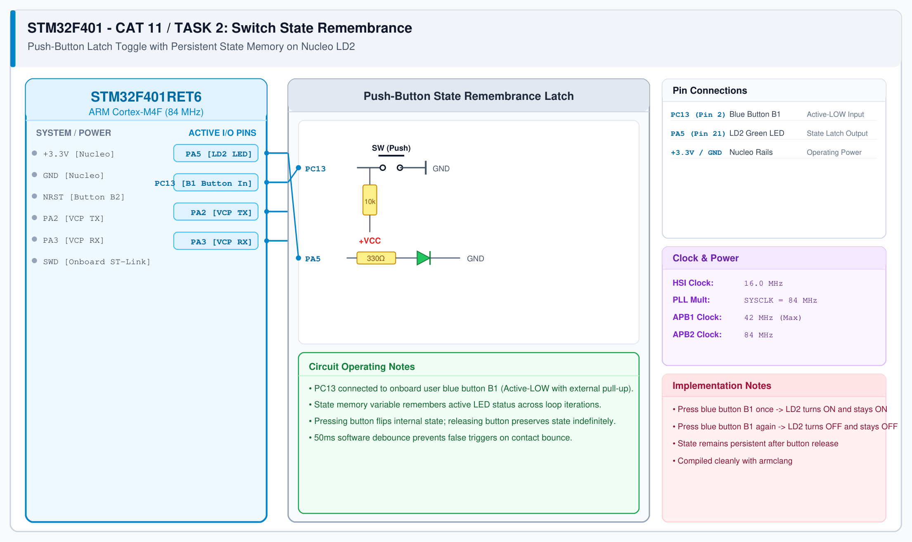

# CAT 12 - Task 12B: Switch State Remembrance

## 1. Experiment Name
**STM32F401 Nucleo Button Latch & Persistent State Memory**

## 2. Hardware Setup and Components
- 1x STM32 Nucleo-F401RE Board
- Onboard Blue Push-Button (PC13, B1)
- Onboard Green LED (PA5, LD2)

## 3. Circuit Diagram

## 4. Required Pin Connections
| Nucleo Pin | Connected To | Function |
|---|---|---|
| PC13 | Blue Push-Button B1 | State toggle input (Active-LOW) |
| PA5 | Green User LED LD2 | Persistent latch indicator |
| +3.3V / GND | Board Rails | Power |

## 5. Clock Configuration
- System Clock: **84 MHz**
- SysTick: 1 ms tick for debounce timing.

## 6. Pseudocode / Code Logic
1. State variable `led_state = 0`.
2. In main loop:
   - If PC13 is pressed (`GPIO_PIN_RESET`):
     - Wait 50 ms debounce delay.
     - If still pressed: toggle `led_state = !led_state`.
     - Update output: `HAL_GPIO_WritePin(GPIOA, GPIO_PIN_5, led_state ? GPIO_PIN_SET : GPIO_PIN_RESET);`
     - Wait for button release: `while (HAL_GPIO_ReadPin(GPIOC, GPIO_PIN_13) == GPIO_PIN_RESET);`
     - Wait 20 ms release debounce.

## 7. Inference / Conclusion
- Successfully implemented persistent state latching without external flip-flop ICs.
- The LED remembers its state indefinitely between presses.
