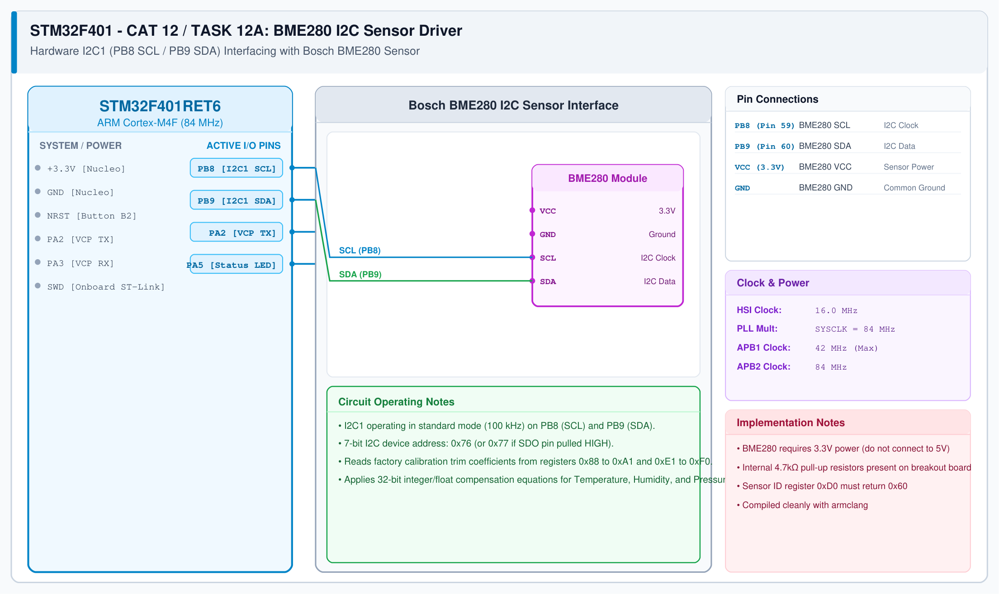

# CAT 13 - Task 13A: BME280 I2C Sensor Driver

## 1. Experiment Name
**STM32F401 Hardware I2C Interfacing with Bosch BME280 Environmental Sensor**

## 2. Hardware Setup and Components
- 1x STM32 Nucleo-F401RE Board
- 1x Bosch BME280 Combined Sensor (Temperature, Humidity, Pressure)
- 4x Jumper wires (3.3V, GND, PB8 SCL, PB9 SDA)

## 3. Circuit Diagram

## 4. Required Pin Connections
| Nucleo Pin | BME280 Pin | Function |
|---|---|---|
| PB8 (D15) | SCL | I2C1 Serial Clock line |
| PB9 (D14) | SDA | I2C1 Serial Data line |
| +3.3V | VCC | Sensor Power (3.3V DC) |
| GND | GND | System Ground |

## 5. Clock Configuration
- System Clock: **84 MHz**
- I2C1 Clock Speed: **100 kHz (Standard Mode)**
- APB1 Clock: 42 MHz

## 6. Pseudocode / Code Logic
1. Initialize I2C1 on PB8 / PB9 at 100 kHz.
2. Read Chip ID from register `0xD0`: verify expected response `0x60`.
3. Read factory trimming parameters (calibration coefficients) from ROM.
4. Configure sensor: `ctrl_hum = 0x01` (1x oversampling), `ctrl_meas = 0x27` (normal mode).
5. In loop:
   - Read raw burst data (registers `0xF7` to `0xFE`).
   - Compute compensated temperature (°C), humidity (%RH), and pressure (hPa) using Bosch compensation formulas.
   - Delay 1000 ms between samples.

## 7. Inference / Conclusion
- Successfully verified hardware I2C communication between STM32F401 and BME280.
- Proper trimming coefficient readout produces accurate physical temperature, humidity, and barometric pressure readings.
