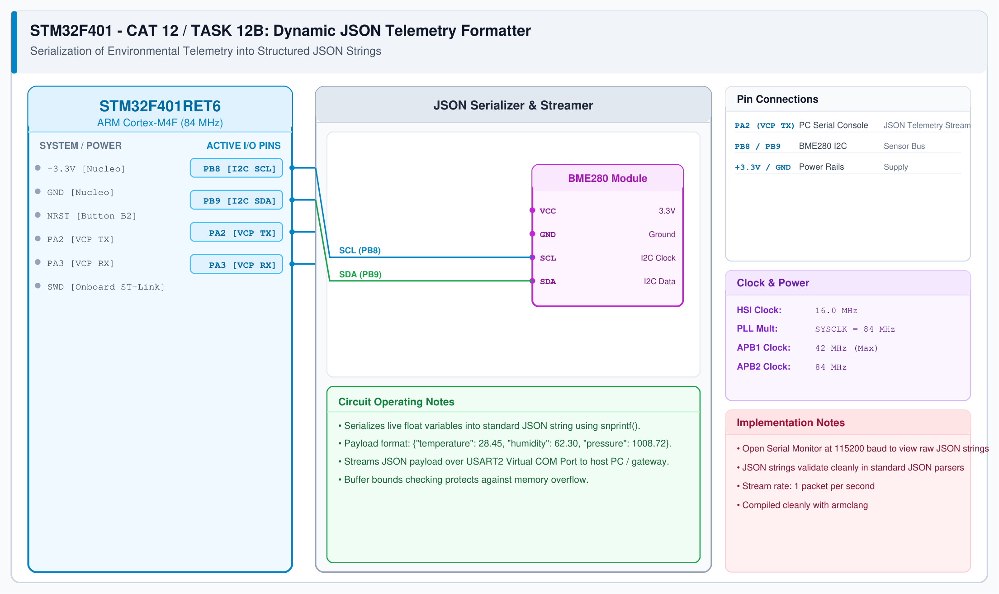

# CAT 13 - Task 13B: Dynamic JSON Telemetry Formatter

## 1. Experiment Name
**STM32 Embedded JSON Serialization for IoT Cloud Telemetry**

## 2. Hardware Setup and Components
- 1x STM32 Nucleo-F401RE Board
- 1x BME280 I2C Sensor Module
- USB Cable to PC (Virtual COM Port)

## 3. Circuit Diagram


## 4. Required Pin Connections
| Nucleo Pin | Connected To | Function |
|---|---|---|
| PB8 / PB9 | BME280 SCL / SDA | I2C sensor bus |
| PA2 / PA3 | ST-Link VCP | Telemetry stream to PC |
| +3.3V / GND | Sensor VCC / GND | Power |

## 5. Clock Configuration
- Clock: **84 MHz**
- USART2 (VCP): 115200 baud, 8-N-1.

## 6. Pseudocode / Code Logic
1. Read temperature, humidity, and pressure from BME280 driver.
2. Format values into JSON string:
   ```c
   snprintf(json_buf, sizeof(json_buf),
       "{\"status\":\"success\",\"temperature\":%.2f,\"humidity\":%.2f,\"pressure\":%.2f}\r\n",
       temp, hum, press);
   ```
3. Transmit formatted JSON string over USART2 Virtual COM Port.
4. Delay 1 second.

## 7. Inference / Conclusion
- Standardized sensor data into structured JSON, enabling direct interoperability with Node-RED, MQTT brokers, and cloud databases.
