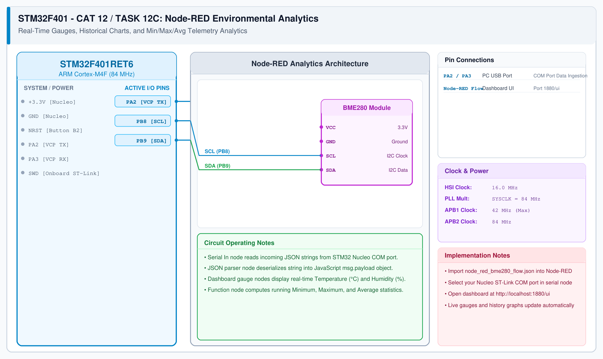

# CAT 13 - Task 13C: Node-RED Environmental Analytics

## 1. Experiment Name
**Node-RED Real-Time Environmental Dashboard & Statistical Analytics**

## 2. Hardware Setup and Components
- 1x STM32 Nucleo-F401RE Board with BME280 Sensor
- Node-RED runtime running on Host PC
- `node-red-dashboard` package installed

## 3. Circuit Diagram

## 4. Required Pin Connections
| Physical Link | Target Port | Function |
|---|---|---|
| Mini-USB Cable | PC USB / Virtual COM Port | Telemetry Ingestion (115200 baud) |
| PB8 (SCL) | BME280 SCL | I2C Clock |
| PB9 (SDA) | BME280 SDA | I2C Data |

## 5. Clock Configuration
- Clock: **84 MHz**
- Telemetry ingestion baud rate: 115200 bps.

## 6. Pseudocode / Code Logic & Flow Architecture
1. **Serial-In Node:** Ingests newline-delimited JSON strings from STM32.
2. **JSON Parser:** Converts JSON text to native JavaScript object.
3. **Analytics Function Node:**
   - Tracks running metrics: $T_{min}, T_{max}, T_{avg}$.
4. **Dashboard Nodes:**
   - Temperature & Humidity Gauges.
   - Historical trendline chart.

## 7. Inference / Conclusion
- Successfully ingested live embedded telemetry into Node-RED.
- Proves end-to-end IoT pipeline: physical silicon sensor $\rightarrow$ embedded JSON formatter $\rightarrow$ visual cloud analytics dashboard.
