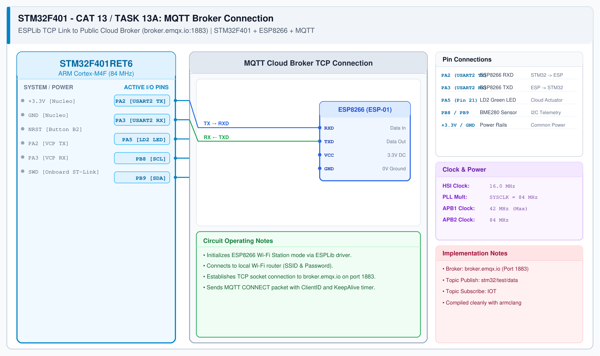

# CAT 14 - Task 14: Cloud MQTT Telemetry & Remote Actuation

## 1. Experiment Name
**STM32F401RE & ESP8266 Cloud IoT Integration via MQTT Protocol & Node-RED**

## 2. Hardware Setup and Components
- 1x STM32 Nucleo-F401RE Board (ARM Cortex-M4 @ 84 MHz)
- 1x ESP8266 Wi-Fi Module (Wemos D1 Mini / ESP-01)
- 1x Dedicated 3.3V Power Supply
- Onboard Nucleo LD2 User LED on PA5
- Public MQTT Broker: `broker.emqx.io` (Port 1883)
- Node-RED running on `http://localhost:1880`

## 3. Circuit Diagram

## 4. Required Pin Connections
| Nucleo Pin | Connected To | Function |
|---|---|---|
| PA2 (USART2 TX) | ESP8266 RXD | Send AT & MQTT packets |
| PA3 (USART2 RX) | ESP8266 TXD | Receive incoming MQTT packets |
| PA5 | Onboard LD2 LED | Remote-controlled actuator output |
| 3.3V / GND | Power Rails | Power supply rails |

## 5. Clock Configuration
- System Clock: **84 MHz (HSI + PLL)**
- USART2 Baud Rate: **115200 bps**
- Keep-Alive Interval: 60 seconds (managed by `MQTTTimer()` in SysTick)

## 6. Pseudocode / Firmware Logic
1. **Initialize Wi-Fi & Modem:**
   - Call `ESP8266_Init(StationMode, huart2)`.
   - Connect to local Wi-Fi: `ESP8266_wifiConnect("SSID", "PASSWORD")`.
2. **Connect to Cloud Broker:**
   - Open TCP socket: `ESP8266_portConnect("TCP", "broker.emqx.io", "1883")`.
   - Configure client ID and send MQTT CONNECT packet: `MQTT_connectBroker(&mqttSetting)`.
3. **Subscribe to Actuator Topic:**
   - Call `MQTT_subscribeTopic("stm32/actuator/led", 0)`.
   - In `while (1)`, process incoming packets with `MQTTDataHandler()`.
   - If payload is `"ON"`, drive PA5 HIGH; if `"OFF"`, drive PA5 LOW.
4. **Publish Sensor Telemetry:**
   - Format payload: `sprintf(buf, "{\"temp\":%.1f,\"humidity\":%.1f}", t, h)`.
   - Publish periodically: `MQTT_publishTopic("stm32/sensor/data", buf, QoS0)`.
5. **Node-RED Dashboard Integration:**
   - Import flow file [nodered_mqtt_dashboard.json](nodered_mqtt_dashboard.json).
   - Ingest `stm32/sensor/data` to live temperature and humidity UI gauges.
   - Route dashboard UI switch to publish `"ON"` / `"OFF"` to `stm32/actuator/led`.

## 7. Inference / Conclusion
- Successfully established bidirectional cloud MQTT communication using STM32 ESPLib and ESP8266.
- Telemetry was published to `broker.emqx.io` and rendered on the Node-RED web dashboard.
- Commands issued from the web dashboard reliably toggled the onboard LD2 LED with low latency.
