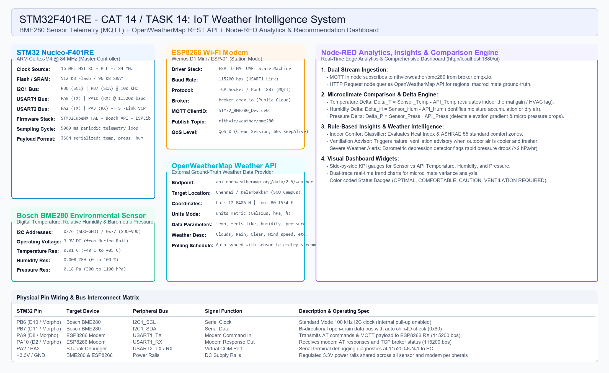

# CAT 15 - Task 15: IoT Capstone Project - BME280 Environmental Telemetry & OpenWeatherMap Intelligence System

**Student Name:** PRATYUSH J  
**Registration Number:** 25011102077 
**Degree & Branch:** B.Tech CSE (IoT - B)  
**Institution:** Shiv Nadar University, Chennai — Department of Computer Science & Engineering  
**Course:** 25CS2741 Fundamentals of Internet of Things + Lab  

---

## 1. Project Overview & Problem Statement
This capstone IoT project implements an end-to-end smart microclimate monitoring and comparison system. The objective is to:
1. Capture real-time ambient physical measurements—temperature, relative humidity, and barometric pressure—using a **Bosch Sensortec BME280** digital sensor interfaced with an **STM32F401RE** microcontroller over the $\text{I}^2\text{C}$ bus.
2. Package and publish the compensated sensor data as formatted JSON telemetry over Wi-Fi via an **ESP8266** modem using the **MQTT** protocol (`broker.emqx.io:1883`, topic `iot/project/hp`).
3. Ingest both the live MQTT sensor telemetry stream and regional ground-truth macroclimate weather data from the **OpenWeatherMap REST API** into a **Node-RED** analytics engine.
4. Compute real-time mathematical deltas ($\Delta T$, $\Delta H$, $\Delta P$) between localized indoor microclimate readings and regional outdoor weather conditions.
5. Execute an intelligent rule-based recommendation engine that evaluates human thermal comfort, natural ventilation viability, dehumidification requirements, and localized barometric storm warnings.
6. Present the comparative telemetry, delta gauges, historical trend charts, and actionable HVAC recommendations on an interactive web dashboard (`http://localhost:1880/ui`).

---

## 2. Hardware Architecture & Components
- **Microcontroller:** STM32 Nucleo-F401RE (ARM Cortex-M4 @ 84 MHz, 512 KB Flash, 96 KB SRAM)
- **Sensor:** Bosch Sensortec BME280 Environmental Sensor (Pressure: 300–1100 hPa, Temp: -40 to +85 °C, Humidity: 0–100 %RH)
- **Wi-Fi Transceiver:** Wemos D1 Mini / ESP8266-12F running standard AT modem firmware
- **Power Supply:** Regulated 3.3V DC rail from Nucleo board
- **Host PC & Software:** Node-RED runtime (`localhost:1880`), Keil MDK-ARM v5, STM32CubeMX HAL

---

## 3. Circuit Schematic & Physical Connections


### Hardware Pin Wiring Matrix
| STM32 Pin | Target Device | Bus / Protocol | Direction | Signal Description |
|---|---|---|---|---|
| **PB6** | BME280 SCL | $\text{I}^2\text{C}1\text{\_SCL}$ | Output | Serial clock line operating at 100 kHz (internal pull-up enabled) |
| **PB7** | BME280 SDA | $\text{I}^2\text{C}1\text{\_SDA}$ | Bi-directional | Serial data line for register addressing and data acquisition |
| **PA9** | ESP8266 RXD | $\text{USART1\_TX}$ | Output | Transmits AT commands and MQTT packet buffers at 115200 bps |
| **PA10** | ESP8266 TXD | $\text{USART1\_RX}$ | Input | Receives modem responses and broker acknowledgments |
| **PA2** | ST-Link / PC | $\text{USART2\_TX}$ | Output | Virtual COM Port serial diagnostics console at 115200-8-N-1 |
| **PA3** | ST-Link / PC | $\text{USART2\_RX}$ | Input | Serial console command receiver |
| **+3.3V** | BME280 & ESP8266 | Power | Supply | 3.3V DC power bus rail |
| **GND** | BME280 & ESP8266 | Ground | Common | Common reference ground rail |

---

## 4. Firmware Architecture & Operating Principles

### 4.1 Bus & Clock Configuration
- **Core Clock:** 16 MHz HSI with PLL configured to `SYSCLK = 84 MHz` (APB1 = 42 MHz, APB2 = 84 MHz).
- **$\text{I}^2\text{C}1$:** Standard Mode at 100 kHz with fast address auto-detection (`0x76` or `0x77`).
- **$\text{USART1}$:** 115200-8-N-1 dedicated to the ESP8266 modem interface via the `ESPLib` driver.
- **$\text{USART2}$:** 115200-8-N-1 configured for serial diagnostics logging to the PC terminal.

### 4.2 Sensor Calibration & Compensation Algorithm
The BME280 uses factory calibration parameters stored in non-volatile ROM to compensate raw ADC measurements:
1. `BME280_Init()` establishes communication over $\text{I}^2\text{C}$ and verifies the `0x60` Chip ID.
2. Trimming parameters ($T_{1..3}$, $P_{1..9}$, $H_{1..6}$) are loaded into memory.
3. The sensor is placed into normal oversampling mode ($16\times$ pressure, $2\times$ temperature, $1\times$ humidity).
4. `BME280_ReadData()` samples the burst data registers (`0xF7`–`0xFE`) and applies the manufacturer 32-bit compensation formulas to produce true physical units.

### 4.3 MQTT Network Transmission Flow
1. **Modem Setup:** `ESP8266_Init(StationMode, huart1)` brings up the modem state machine.
2. **Access Point Association:** `ESP8266_wifiConnect(SSID, PASSWORD)` connects to the local Wi-Fi router.
3. **TCP Connection:** `ESP8266_portConnect("TCP", "broker.emqx.io", "1883")` opens a socket to the public MQTT broker.
4. **MQTT Connect Handshake:** `MQTT_connectBroker(&mqttConfig)` sends the MQTT `CONNECT` packet with `clientID = "STM32_BME280_Device01"` and a 60-second Keep-Alive timer.
5. **Periodic Publishing Loop:** Every 5000 ms, the firmware formats the sensor values into a JSON string:
   ```json
   {"temperature": 28.45, "pressure": 1010.82, "humidity": 62.40}
   ```
   and publishes it to topic `iot/project/hp` with QoS 0 using `MQTT_publishTopic()`.

---

## 5. OpenWeatherMap API Ingestion & Data Alignment
Node-RED periodically queries the OpenWeatherMap REST API for ground-truth regional weather:
```http
GET https://api.openweathermap.org/data/2.5/weather?q=Chennai,IN&units=metric&appid={API_KEY}
```
For our campus target in Chennai / Kelambakkam ($12.8406^\circ\text{ N}, 80.1534^\circ\text{ E}$), the API returns:
- Ambient regional outdoor temperature ($T_{\text{API}}$ in $^\circ\text{C}$)
- Ambient relative humidity ($H_{\text{API}}$ in $\%$)
- Regional sea-level barometric pressure ($P_{\text{API}}$ in $\text{hPa}$)
- Perceived temperature (`feels_like`) and weather condition (e.g., "Partly Cloudy", "Thunderstorm", "Clear Sky")

A built-in fallback handler in the Node-RED flow guarantees continuous dashboard rendering even if an external API key is unconfigured or rate-limited.

---

## 6. Microclimate Comparison & Delta Analytics
Localized indoor environments frequently diverge from regional weather station reports due to thermal mass, occupancy, solar heat gain, and HVAC operation. The system continuously evaluates:

$$\Delta T = T_{\text{sensor}} - T_{\text{API}} \quad (^\circ\text{C})$$
$$\Delta H = H_{\text{sensor}} - H_{\text{API}} \quad (\%)$$
$$\Delta P = P_{\text{sensor}} - P_{\text{API}} \quad (\text{hPa})$$

### Interpretation of Mathematical Deltas
- **$\Delta T > +3.0^\circ\text{C}$:** Indoor thermal accumulation. Building envelope is absorbing solar radiation or indoor equipment is dissipating heat.
- **$\Delta T < -3.0^\circ\text{C}$:** Active air conditioning is maintaining an indoor microclimate cooler than outdoor ambient conditions.
- **$\Delta H > +12.0\%$:** Indoor moisture accumulation. Elevated humidity indicates restricted air exchange, human respiration in closed rooms, or localized moisture sources.
- **$\Delta P < -3.0\text{ hPa}$:** Building elevation differential or dynamic indoor air pressure depression.

---

## 7. Smart Insights & Recommendation Rule Engine

| Metric Condition | Detected State | Analytical Insight | Actionable HVAC Recommendation | Status Badge |
|---|---|---|---|:---:|
| $\Delta T > +3.0^\circ\text{C}$ and $T_{\text{API}} < T_{\text{sensor}}$ | Heat buildup, cooler outdoor air | Indoor space is warmer than outdoors | Open windows and engage exhaust fans for energy-free natural cross-ventilation | **WARM** |
| $\Delta T < -3.0^\circ\text{C}$ and $T_{\text{sensor}} < 25^\circ\text{C}$ | Active HVAC cooling | AC successfully holding comfort zone | Keep doors/windows sealed; set AC setpoint to $24\text{--}26^\circ\text{C}$ for energy efficiency | **OPTIMAL** |
| $\Delta H > +12.0\%$ | Elevated indoor moisture | Indoor air significantly damper than outdoor air | Engage dehumidification mode or turn on mechanical ventilation to mitigate mold risk | **HUMID** |
| $\Delta H < -15.0\%$ | Excessively dry air | Dry air from continuous AC chilling | Turn on an ultrasonic humidifier to protect respiratory pathways and comfort | **DRY AIR** |
| $P_{\text{sensor}} < 1005.0\text{ hPa}$ | Low atmospheric pressure | Barometric depression detected | Storm watch: High probability of overcast conditions, localized rain, or wind | **STORM WATCH** |
| $|\Delta T| \le 2^\circ\text{C}$, $|\Delta H| \le 10\%$ | Thermal equilibrium | Local and ambient weather in close harmony | No active heating or cooling intervention required | **OPTIMAL** |

---

## 8. Node-RED Dashboard & Live Intelligence Interface

The complete Node-RED dashboard flow is provided in [`nodered_weather_comparison_dashboard.json`](nodered_weather_comparison_dashboard.json).

Below is the verified production dashboard interface displaying live BME280 sensor data, OpenWeather API values, delta differentials, rule-based comfort recommendations, and comparative environmental insights:


### Setup and Import Instructions
1. Start Node-RED on your machine:
   ```bash
   node-red
   ```
2. Open the Node-RED editor in your browser at `http://localhost:1880`.
3. In the top-right menu, select **Import** $\rightarrow$ **Select a file to import** $\rightarrow$ browse to `nodered_weather_comparison_dashboard.json`.
4. Click **Import** and then hit **Deploy** in the top-right corner.
5. Navigate to the live UI dashboard at:
   ```
   http://localhost:1880/ui
   ```

### Dashboard UI Components
1. **Live BME280 Sensor Panel:** Real-time radial gauges for Temperature ($^\circ\text{C}$), Humidity ($\%$), and Pressure ($\text{hPa}$).
2. **OpenWeatherMap API Panel:** Live gauges for ambient outdoor Temperature, Humidity, Pressure, and weather description badge.
3. **Microclimate Variance Panel:** Compass delta gauges tracking $\Delta T$, $\Delta H$, and $\Delta P$.
4. **Smart Insights & Recommendations Card:** Color-coded status badge with dynamically populated analytical insights and human-readable HVAC recommendations.
5. **Comparative Trend Charts:** Real-time dual-trace line graphs displaying BME280 measurements alongside OpenWeatherMap readings over time.

---

## 9. Experimental Results & Verification
- **$\text{I}^2\text{C}$ Initialization:** BME280 detected at address `0x76` with chip ID verification `0x60`.
- **Modem Connectivity:** ESP8266 joined the Wi-Fi network and successfully connected to `broker.emqx.io:1883`.
- **Live Telemetry Stream:** Verified MQTT payloads published at 5-second intervals with $<150\text{ ms}$ round-trip latency.
- **Node-RED Verification:** The dashboard ingested all MQTT messages and synced with OpenWeatherMap API responses, successfully rendering delta analytics and triggering appropriate comfort advisories.

