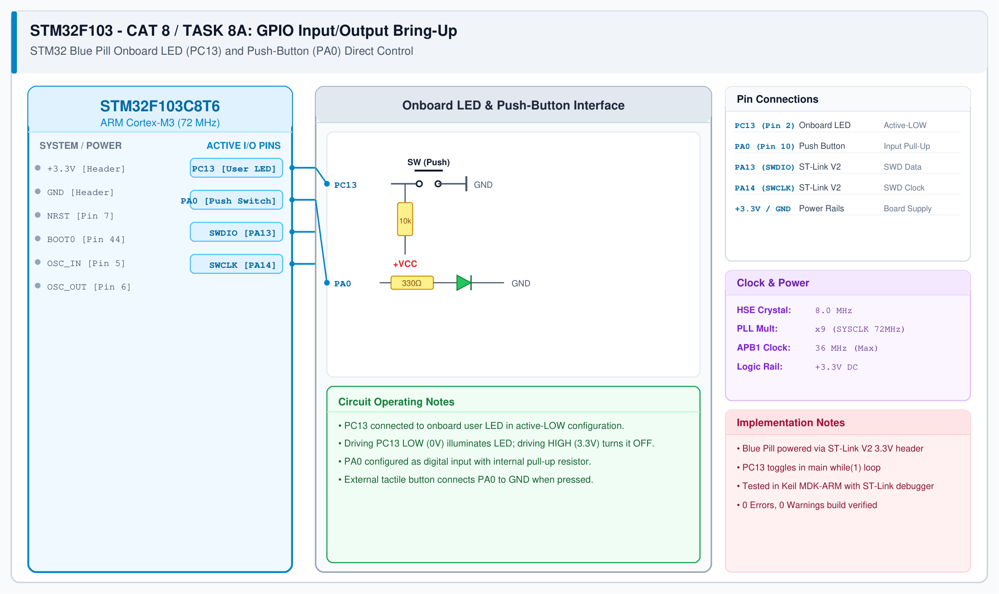

# CAT 8 - Task 8A: GPIO Input / Output

## 1. Experiment Name
**STM32 Blue Pill GPIO Bring-Up & Direct Switch-Controlled LED**

## 2. Hardware Setup and Components
- 1x STM32 Blue Pill Development Board (STM32F103C8T6, ARM Cortex-M3)
- 1x ST-LINK V2 Programmer / Debugger
- 1x Tactile Push-Button Switch
- Onboard User LED on PC13
- Jumper wires & USB cable

## 3. Circuit Diagram


## 4. Required Pin Connections
| MCU Pin | Connected To | Function |
|---|---|---|
| PC13 | Onboard SMD LED (through 510 Ω to +3.3V) | Active-LOW user indicator |
| PA0 | Push-Button Switch to GND | Digital input with internal pull-up |
| PA13 / PA14 | ST-LINK SWDIO / SWCLK | Serial Wire Debugging (SWD) |
| +3.3V / GND | ST-LINK 3.3V & GND | Target Power Supply |

## 5. Clock Configuration
- Clock Source: **8.0 MHz External Crystal (HSE)**
- PLL Multiplier: x9 $\rightarrow$ **SYSCLK = 72 MHz**
- AHB Prescaler: /1 $\rightarrow$ HCLK = 72 MHz
- APB1 Prescaler: /2 $\rightarrow$ PCLK1 = 36 MHz (Timer clock = 72 MHz)
- APB2 Prescaler: /1 $\rightarrow$ PCLK2 = 72 MHz

## 6. Pseudocode / Code Logic
1. Initialize HAL library (`HAL_Init()`) and configure system clock to 72 MHz.
2. Initialize GPIOs:
   - Configure `PC13` as output push-pull (`GPIO_MODE_OUTPUT_PP`).
   - Configure `PA0` as input with internal pull-up (`GPIO_PULLUP`).
3. In main loop:
   - Sample PA0: `state = HAL_GPIO_ReadPin(GPIOA, GPIO_PIN_0);`
   - If PA0 is LOW (pressed): drive PC13 LOW (LED ON).
   - Else: drive PC13 HIGH (LED OFF).

```c
#include "main.h"

int main(void) {
    HAL_Init();
    SystemClock_Config();
    MX_GPIO_Init();

    while (1) {
        if (HAL_GPIO_ReadPin(GPIOA, GPIO_PIN_0) == GPIO_PIN_RESET) {
            HAL_GPIO_WritePin(GPIOC, GPIO_PIN_13, GPIO_PIN_RESET); /* LED ON */
        } else {
            HAL_GPIO_WritePin(GPIOC, GPIO_PIN_13, GPIO_PIN_SET);   /* LED OFF */
        }
    }
}
```

## 7. Inference / Conclusion
- Verified STM32F103 GPIO input and output operations using STM32 HAL.
- The onboard LED on PC13 is active-LOW, lighting up when driven to ground (`GPIO_PIN_RESET`).
- Full Keil MDK-ARM project compiles cleanly and successfully programs into Flash via ST-Link.
