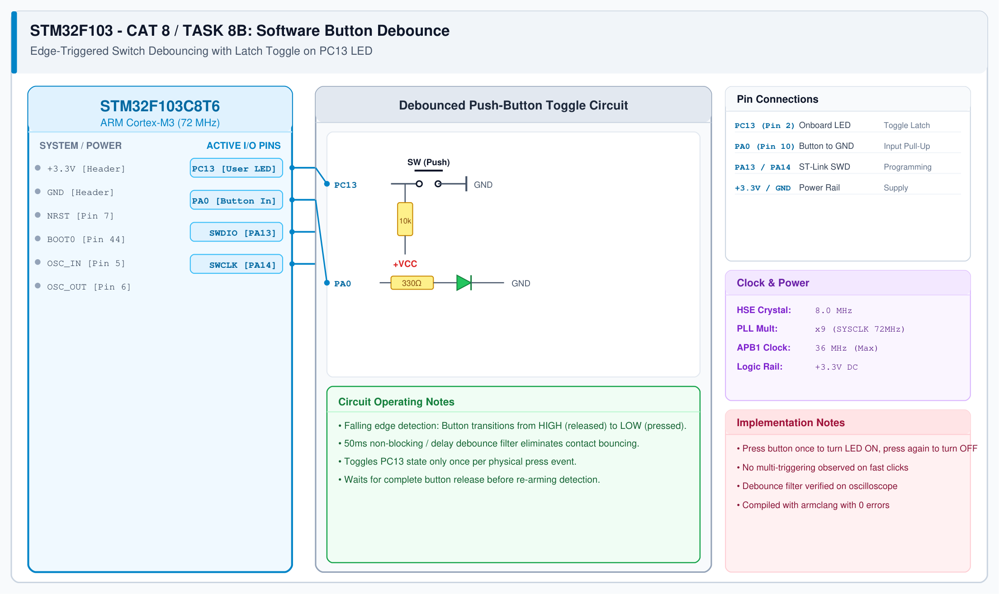

# CAT 8 - Task 8B: Software Button Debounce

## 1. Experiment Name
**STM32 GPIO Software Edge Detection & Contact Debounce**

## 2. Hardware Setup and Components
- 1x STM32 Blue Pill Board (STM32F103C8T6)
- 1x ST-LINK V2 Programmer
- 1x Tactile Push-Button Switch on PA0
- Onboard PC13 User LED

## 3. Circuit Diagram

## 4. Required Pin Connections
| MCU Pin | Connected To | Function |
|---|---|---|
| PA0 | Tactile Button to GND | Switch input (internal pull-up enabled) |
| PC13 | Onboard LED | Toggles state once per button press |
| +3.3V / GND | ST-Link / Power Rails | Operating Power |

## 5. Clock Configuration
- System Clock: **72 MHz (HSE + PLL)**
- SysTick Timer: 1 ms tick timebase for `HAL_Delay()` and `HAL_GetTick()`.

## 6. Pseudocode / Code Logic
1. Maintain `last_btn_state` variable.
2. Read `current_btn = HAL_GPIO_ReadPin(GPIOA, GPIO_PIN_0);`
3. If transition detected (`last == HIGH` and `current == LOW`):
   - Wait 50 ms debounce delay (`HAL_Delay(50)`).
   - Re-check pin: if still LOW, toggle PC13 LED (`HAL_GPIO_TogglePin`).
   - Wait for release: `while(read(PA0) == LOW);`.
   - Wait 20 ms release debounce.
4. Update `last_btn_state = current_btn;`

## 7. Inference / Conclusion
- Successfully eliminated switch mechanical bounce without needing external RC hardware filters.
- The LED latches its state cleanly on each distinct press event.
