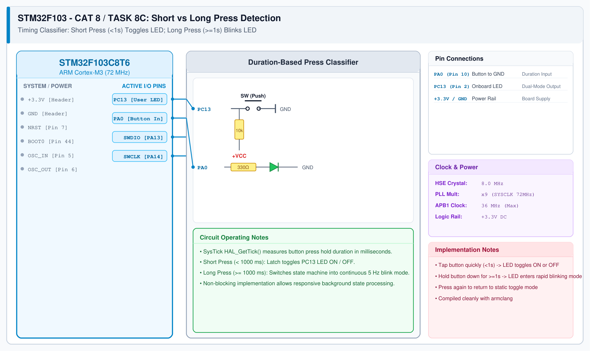

# CAT 8 - Task 8C: Short vs Long Press Detection

## 1. Experiment Name
**STM32 Non-Blocking Timing Classifier: Short Press vs. Long Press**

## 2. Hardware Setup and Components
- 1x STM32 Blue Pill Board
- 1x Push-Button Switch on PA0
- Onboard PC13 LED & ST-Link V2

## 3. Circuit Diagram

## 4. Required Pin Connections
| MCU Pin | Connected To | Function |
|---|---|---|
| PA0 | Button to GND | Timing input (internal pull-up) |
| PC13 | Onboard LED | Short press = Toggle, Long press = Blink |
| +3.3V / GND | Power Rails | System Power |

## 5. Clock Configuration
- Clock: **72 MHz**
- Timebase: `HAL_GetTick()` provides continuous 1 ms resolution counter.

## 6. Pseudocode / Code Logic
1. State machine: `STATE_TOGGLE` (static latch) and `STATE_BLINK` (continuous blinking).
2. When PA0 falls to LOW: record `t_press = HAL_GetTick()`.
3. When PA0 rises to HIGH: calculate `duration = HAL_GetTick() - t_press`.
   - If `duration < 1000 ms`: Toggle LED in place.
   - If `duration >= 1000 ms`: Toggle active mode between `STATE_TOGGLE` and `STATE_BLINK`.
4. If in `STATE_BLINK`: toggle LED every 100 ms using non-blocking timestamp comparison.

## 7. Inference / Conclusion
- Successfully classified user switch interactions using SysTick millisecond timing without blocking the CPU.
- Differentiates quick taps from deliberate long holds reliably.
