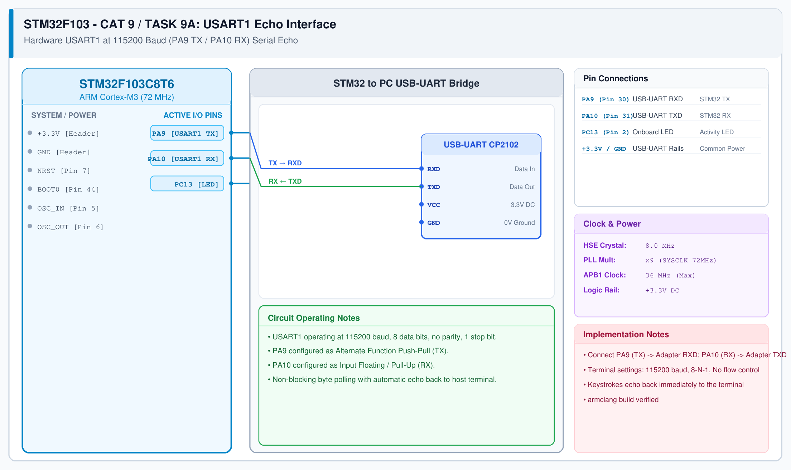

# CAT 9 - Task 9A: Basic UART Communication

## 1. Experiment Name
**STM32F103 USART1 115200 Baud Hardware Serial Echo**

## 2. Hardware Setup and Components
- 1x STM32 Blue Pill Board
- 1x CP2102 / FT232 USB-to-UART Module
- PC with Serial Terminal (115200 baud)

## 3. Circuit Diagram

## 4. Required Pin Connections
| MCU Pin | Connected To | Function |
|---|---|---|
| PA9 | USB-UART RXD | STM32 USART1 Transmit |
| PA10 | USB-UART TXD | STM32 USART1 Receive |
| GND | USB-UART GND | Common Signal Ground |

## 5. Clock Configuration
- Clock: **72 MHz** (PCLK2 = 72 MHz for USART1)
- Baud Rate: **115200 bps**, 8 data bits, no parity, 1 stop bit.

## 6. Pseudocode / Code Logic
1. Initialize USART1 at 115200 baud using STM32 HAL.
2. Transmit startup banner: `"=== STM32 USART1 Echo Ready ===\r\n"`.
3. In loop:
   - Poll `HAL_UART_Receive(&huart1, &rx_data, 1, 100)`.
   - If received `HAL_OK`: echo byte back via `HAL_UART_Transmit(&huart1, &rx_data, 1, 10)`.

## 7. Inference / Conclusion
- Verified 115200 baud asynchronous serial communication on STM32F103 USART1.
- Immediate byte echo validates proper clock prescaling on the APB2 peripheral bus.
