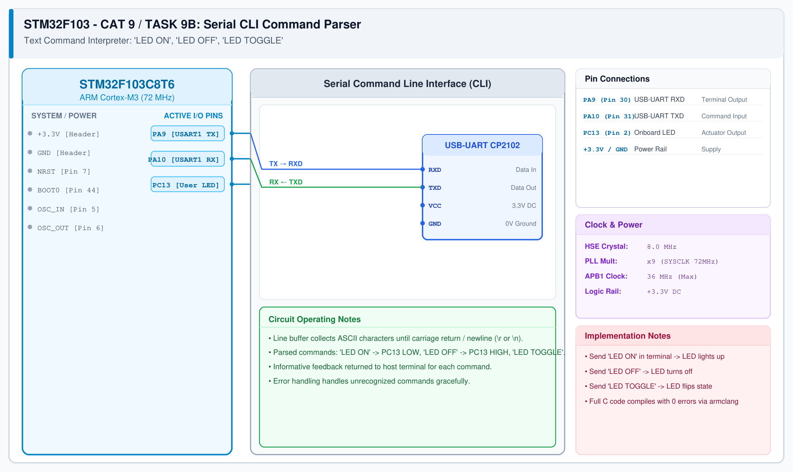

# CAT 9 - Task 9B: Serial CLI Command Parser

## 1. Experiment Name
**STM32 USART String Command Interpreter & Peripheral Actuation**

## 2. Hardware Setup and Components
- 1x STM32 Blue Pill Board
- 1x USB-to-UART Adapter
- PC Serial Terminal (115200 baud)

## 3. Circuit Diagram

## 4. Required Pin Connections
| MCU Pin | Connected To | Function |
|---|---|---|
| PA9 | USB-UART RXD | CLI Prompt and Response Transmit |
| PA10 | USB-UART TXD | Command String Receive |
| PC13 | Onboard LED | Actuated peripheral |
| GND | USB-UART GND | Common Ground |

## 5. Clock Configuration
- Clock: **72 MHz**
- USART1: 115200 baud, 8-N-1.

## 6. Pseudocode / Code Logic
1. Buffer incoming characters into array until `\r` or `\n` is received.
2. Null-terminate string: `cmd_buffer[idx] = '\0'`.
3. Compare string:
   - If `"LED ON"`: drive PC13 LOW and reply `"LED turned ON\r\n"`.
   - If `"LED OFF"`: drive PC13 HIGH and reply `"LED turned OFF\r\n"`.
   - If `"LED TOGGLE"`: toggle PC13 and reply `"LED toggled\r\n"`.
   - Else: reply `"Error: Unrecognized command\r\n"`.
4. Reset buffer index for next command.

## 7. Inference / Conclusion
- Successfully built a serial command line interface (CLI) on STM32.
- String command parsing enables remote control and interactive debugging of embedded peripherals.
